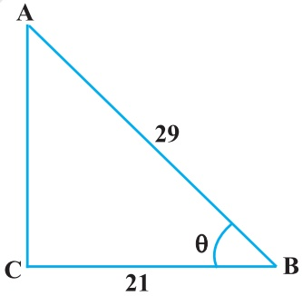

Then

$$
\frac{ AC }{ AB } = \frac{ PR }{ PQ }
$$

Therefore,

$$
\frac{AC}{PR} = \frac{AB}{PQ} = k,\  say\tag{1}
$$

Now, using Pythagoras theorem,

$$
\mathrm{BC} = \sqrt{\mathrm{AB}^2 - \mathrm{AC}^2}
$$

and

$$
\mathrm{QR} = \sqrt{\mathrm{PQ}^2 - \mathrm{PR}^2}
$$

BC √AB2 -AC² √k2PQ2−k2PR2 k√PQ2-PR2 So, QR √PQ2- PR2 √PQ2-PR2 √PQ2-PR2 = k

(2)

From (1) and (2), we have

$$
\frac{\mathrm{AC}}{\mathrm{PR}} = \frac{\overline{\mathrm{AB}}}{\mathrm{PQ}} = \frac{\overline{\mathrm{BC}}}{\overline{\mathrm{QR}}}
$$

Then, by using Theorem 6.4, $\Delta \mathrm{ACB} \sim \Delta \mathrm{PRQ}$ and therefore, $\angle \mathbf { B } = \angle \mathbf { Q }$

Example 3 : Consider $\Delta   \mathrm { A C B }$ right-angled at C, in which $\mathrm { A B } = 2 9$ units, BC = 21 units and $\angle ABC = \theta$ (see Fig. 8.10). Determine the values of

(i) $\cos ^ { 2 } \theta + \sin ^ { 2 } \theta ,$

(ii) $\cos ^ { 2 } \theta - \sin ^ { 2 } \theta$

Solution : In $\Delta   \mathrm { A C B }$ , we have

$$
\mathrm{AC} = \sqrt[3]{\mathrm{AB}^{2} - \mathrm{BC}^{2}} = \sqrt{(29)^{2} - (21)^{2}}
$$

Fig. 8.10

$$
\ln { \sqrt { ( 2 9 - 2 1 ) ( 2 9 + 2 1 ) } } = { \sqrt { ( 8 ) ( 5 0 ) } } = { \sqrt { 4 0 0 } }   = 2 0   { \mathrm { u n i t s } }
$$

So,

$$
\sin \theta = \frac{AC}{AB} = \frac{20}{29}, \cos \theta = \frac{BC}{AB} = \frac{21}{29}.
$$

Now, (i) $\cos ^{2}\theta +\sin ^{2}\theta =\left ( \frac{20}{29} \right ) ^{2} +\left ( \frac{21}{29} \right ) ^{2} =\frac{20^{2} +21^{2}}{29^{2}} =\frac{400+441}{841} =1,$

and (ii) $\cos ^{2}\theta -\sin ^{2}\theta =\left ( \frac{21}{29} \right ) ^{2} -\left ( \frac{20}{29} \right ) ^{2} =\frac{(21+20)(21-20)}{29^{2}} =\frac{41}{841}$