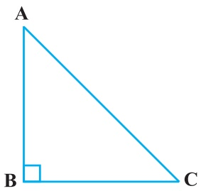
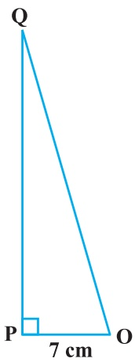

**Example 4 :** In a right triangle ABC, right-angled at B, if tan A = 1, then verify that

2 sin A cos A = 1.

**Solution :** In   ABC, tan $\mathrm { A }   =   { \frac { \mathrm { B C } } { \mathrm { A B } } } = 1$ (see Fig 8.11)

i.e.,

$$
\mathrm { B C } = \mathrm { A B }
$$

Fig. 8.11

Let $\mathrm{AB} = \mathrm{BC} = k$ , where k is a positive number.

Now,

$$
\begin{aligned} AC  &= \sqrt{ AB ^2 +  BC ^2} \\&= \sqrt{\left(k\right)^2 + \left(k\right)^2} = k\sqrt{2}.\end{aligned}
$$

Therefore,

$\sin A = \frac{BC}{AC} = \frac{1}{\sqrt{2}}$ and cos $\mathrm{A} = \frac{\mathrm{AB}}{\mathrm{AC}} = \frac{1}{\sqrt{2}}$

So, 2 sin A cos $2\left(\frac{1}{\sqrt{2}}\right)\left(\frac{1}{\sqrt{2}}\right)=1,$ which is the required value.

**Example 5 :** In $\mathrm { { \it { K } } } \mathrm { { \it { O P Q } } }$ , right-angled at P, $\mathrm { O P } = 7$ cm and $\mathrm{OQ} \sim \mathrm{PQ} = 1$ cm (see Fig. 8.12). Determine the values of sin Q and cos Q.

**Solution :** In $\Delta \; \mathrm { O P Q } ,$ , we have

$$
\mathrm{OQ^{2}} = \mathrm{OP^{2}} + \mathrm{PQ^{2}}
$$

i.e.,

$$
(1 + \mathrm{PQ})^2 = \mathrm{OP}^2 + \mathrm{PQ}^2 \quad (\mathrm{Why?})
$$

i.e.,

$$
1 + \mathrm{PQ}^{2} + 2\mathrm{PQ} = \mathrm{OP}^{2} + \mathrm{PQ}^{2}
$$

i.e.,

$$
1 + 2\mathrm{PQ} = 7^{2}
$$

(Why?)

i.e., PQ = 24 cm and OQ = 1 + PQ = 25 cm

So, $\sin Q = { \frac { 7 } { 2 5 } }$ and cos $\mathsf { Q } = { \frac { 2 4 } { 2 5 } } \cdotp$

Fig. 8.12