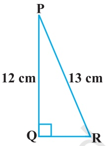

## EXERCISE 8.1

1. In   ABC, right-angled at B, AB = 24 cm, BC = 7 cm. Determine : (i) sin A, cos A (ii) sin C, cos C

**2.** In Fig. 8.13, find tan P – cot R.

3. If $\sin \mathrm { A } = { \frac { 3 } { 4 } }$ , calculate cos A and tan A.

**4.** Given 15 cot A = 8, find sin A and sec A.

5. ${ \mathrm { G i v e n } } \; { \mathrm { s e c } } \; \Theta = { \frac { 1 3 } { 1 2 } } ,$ calculate all other trigonometric ratios.

Fig. 8.13

6. $\mathrm { I f } \angle \mathrm { A a n d } \angle \mathrm { B }$ are acute angles such that cos A = cos B, then show that $\angle \mathrm{A} \cong \angle \mathrm{B}$

**7.** If $\cot \theta = { \frac { 7 } { 8 } } ,$ , evaluate : (i) $\frac{(1+\sin\ \theta)(1-\sin\ \theta)}{(1+\cos\ \theta)(1-\cos\ \theta)}$ (ii) $\cot^{2}\theta$

**8.** If 3 cot A = 4, check whether $\frac{1 - \tan^{2}\mathrm{A}}{1 + \tan^{2}\mathrm{A}} = \cos^{2}\mathrm{A} - \sin^{2}\mathrm{A}$ or not.

**9.** In triangle ABC, right-angled at B, if tan $\mathrm { A } = { \frac { 1 } { \sqrt { 3 } } } ,$ find the value of: (i) sin A cos C + cos A sin C (ii) cos A cos C – sin A sin C

**10.** In   PQR, right-angled at Q, PR + QR = 25 cm and PQ = 5 cm. Determine the values of sin P, cos P and tan P.

**11.** State whether the following are true or false. Justify your answer.

(i) The value of tan A is always less than 1.

(ii) sec $\mathrm { A } = { \frac { 1 2 \mathrm { s } } { 5 } }$ for some value of angle A.

(iii) cos A is the abbreviation used for the cosecant of angle A.

(iv) cot A is the product of cot and A.

(v) sin $\Theta   =   \frac { 4 } { 3 }$ for some angle  .

## 8.3 Trigonometric Ratios of Some Specific Angles

From geometry, you are already familiar with the construction of angles of $3 0 ^ { \circ }$ , 45°, $6 0 ^ { \circ }$ and $9 0 ^ { \circ }$ . In this section, we will find the values of the trigonometric ratios for these angles and, of course, for $0 ^ { \circ }$