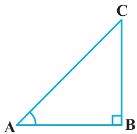
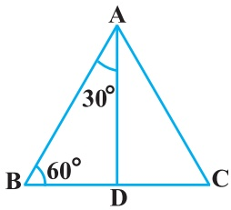

## Trigonometric Ratios of $4 5 ^ { \circ }$

In $\Delta   \mathrm { A B C } ,$ right-angled at B, if one angle is $4 5 ^ { \circ }$ , then the other angle is also $4 5 ^ { \circ } , \mathrm { i . e . } , \angle \mathrm { A } = \angle \mathrm { C } = 4 5 ^ { \circ }$ (see Fig. 8.14).

So,

$$
\mathrm{BC} = \mathrm{AB} \quad (\mathrm{Why?})
$$

Now, Suppose $\mathrm{BC} = \mathrm{AB} = a.$

Fig. 8.14

Then by Pythagoras Theorem, $AC^{2} = AB^{2} + BC^{2} = a^{2} + a^{2} = 2a^{2}$

and, therefore, $\mathrm { A C } =   a { \sqrt { 2 } }   .$

Using the definitions of the trigonometric ratios, we have :

$$
\sin 45^{\circ} = \frac{ side opposite to angle   45^{\circ}}{ hyponeuse } = \frac{BC}{AC} = \frac{a}{a\sqrt{2}} = \frac{1}{\sqrt{2}}
$$

$$
\cos 45^{\circ} = \frac{\overline{ side adjacent to angle 45^{\circ}}}{\overline{ hypotenuse }} = \frac{\overline{AB}}{\overline{AC}} = \frac{a}{a\sqrt{2}} = \frac{1}{\sqrt{2}}
$$

$$
\tan 45^{\circ} = \frac{\overline{side opposite to angle 45^{\circ}}}{\overline{side adjacent to angle 45^{\circ}}} = \frac{\overline{BC}}{\overline{AB}} = \frac{a}{a} = 1
$$

Also, cosec $45^{\circ} = \frac{1}{\sin 45^{\circ}} = \sqrt{2}$ , sec $45^{\circ} = \frac{1}{\cos 45^{\circ}} = \sqrt{2}$ , cot $4 5 ^ { \circ } = { \frac { 1 } { \tan   4 5 ^ { \circ } } }   =   1$

## Trigonometric Ratios of $\mathbf { 3 0 ^ { \circ } }$ and $\mathbf { 6 0 ^ { \circ } }$

Let us now calculate the trigonometric ratios of $3 0 ^ { \circ }$ and $6 0 ^ { \circ }$ . Consider an equilateral triangle ABC. Since each angle in an equilateral triangle is $6 0 ^ { \circ }$ , therefore, $\angle \mathrm{A} = \angle \mathrm{B} = \angle \mathrm{C} = 60^{\circ}$

Draw the perpendicular AD from A to the side BC (see Fig. 8.15).

Fig. 8.15

Now

$$
\Delta \: \mathrm { A B D } \cong \Delta \: \mathrm { A C D } \quad \mathrm { ( W h y ? ) }
$$

Therefore,

$$
\mathrm { B D } = \mathrm { D C }
$$

and

$$
\angle  BAD = \angle  CAD  \left(  CPCT  \right)
$$

Now observe that:

ABD is a right triangle, right - angled at D with $\angle BAD = 30^{\circ}   and   \angle ABD = 60^{\circ}$ (see Fig. 8.15).