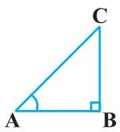
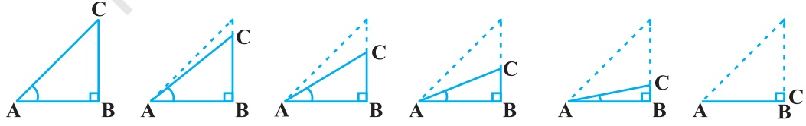

As you know, for finding the trigonometric ratios, we need to know the lengths of the sides of the triangle. So, let us suppose that $\mathrm { A B } = 2 a$

Then,

$$
\mathrm { B D } =   { \frac { 1 } { 2 } } \mathrm { B C } = a .
$$

and

$$
\mathrm{AD}^{2}=\mathrm{AB}^{2}-\mathrm{BD}^{2}=(2a)^{2}-(a)^{2}=3a^{2},
$$

Therefore,

$$
AD =\overset{\cdot}{a\sqrt{3}}
$$

Now, we have :

$$
\sin 30^{\circ} = \frac{BD}{AB} = \frac{a}{2a} = \frac{1}{2}, \cos 30^{\circ} = \frac{AD}{AB} = \frac{a\sqrt{3}}{2a} = \frac{\sqrt{3}}{2}
$$

$$
\tan 30^{\circ} = \frac{\mathrm{BD}}{\mathrm{AD}} = \frac{a}{a\sqrt{3}} = \frac{1}{\sqrt{3}}
$$

Also, cosec $3 0 ^ { \circ } = \frac { 1 } { \sin 3 0 ^ { \circ } } = 2 ,$ sec $30^{\circ} - \frac{1}{\cos 30^{\circ}} = \frac{2}{\sqrt[3]{3}}$

$$
\cot 30^{\circ} = \frac{1}{\tan 30^{\circ}} = \sqrt{3}
$$

Similarly,

$$
\sin 60^{\circ} = \frac{AD}{AB} = \frac{a\sqrt{3}}{2a} = \frac{\sqrt{3}}{2}, \cos 60^{\circ} = \frac{1}{2}, \tan 60^{\circ} = \sqrt{3}
$$

cosec $6 0 ^ { \circ } = ( \frac { 2 } { \sqrt { 3 } } )$ sec $6 0 ^ { \circ } = 2$ and cot $6 0 ^ { \circ } = { \frac { 1 } { \sqrt { 3 } } }$

Trigonometric Ratios of $\mathbf { 0 } ^ { \circ }$ and $\mathbf { 9 0 ^ { \circ } }$

Let us see what happens to the trigonometric ratios of angle A, if it is made smaller and smaller in the right triangle ABC (see Fig. 8.16), till it becomes zero. $\mathrm { A s }   \angle \mathrm { A }$ gets smaller and smaller, the length of the side BC decreases.The point C gets closer to point B, and finally when $\mathrm { \angle A }$ becomes very close to $0 ^ { \circ }$ , AC becomes almost the same as AB (see Fig. 8.17).

Fig. 8.16

Fig. 8.17