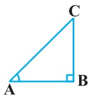
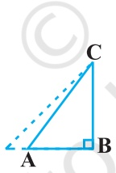
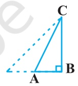
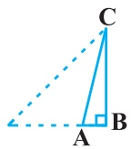
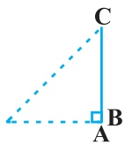

When $\angle \mathrm { ~ A ~ }$ is very close to $0 ^ { \circ }$ , BC gets very close to 0 and so the value of sin $\mathrm { A } = { \frac { \mathrm { B C } } { \mathrm { A C } } }$ is very close to 0. Also, when $\angle \mathrm { A }$ is very close to $0 ^ { \circ }$ , AC is nearly the same as AB and so the value of cos $\mathrm { A } = { \frac { \mathrm { A B } } { \mathrm { A C } } }$ is very close to 1.

This helps us to see how we can define the values of sin A and cos A when $\mathbf { A } = 0 ^ { \circ }$ **.** We define : sin $\mathbf { 0 } ^ { \circ } = \mathbf { 0 }$ and cos $\mathbf { 0 } ^ { \circ } = \mathbf { 1 }$

Using these, we have :

tan $0 ^ { \circ } = { \frac { \sin   0 ^ { \circ } } { \cos   0 ^ { \circ } } }   = 0 ,$ cot $0 ^ { \circ } = { \frac { 1 } { \tan 0 ^ { \circ } } }$ ,   which is not defined. (Why?)

sec $0 ^ { \circ } = { \frac { 1 } { \cos   0 ^ { \circ } } } = 1$ and cosec $0 ^ { \circ } = \frac { 1 } { \sin 0 ^ { \circ } }$ which is again not defined.(Why?)

Now, let us see what happens to the trigonometric ratios of $\angle \mathrm{A}$ , when it is made larger and larger in   ABC till it becomes $90^{\circ}.\mathrm{As} \angle \mathrm{A}$ gets larger and larger, $\angle \mathrm { C }$ gets smaller and smaller. Therefore, as in the case above, the length of the side AB goes on decreasing. The point A gets closer to point B. Finally when $\angle \mathrm { A }$ is very close to $9 0 ^ { \circ }$ $\angle \mathrm { ~ C ~ }$ becomes very close to $0 ^ { \circ }$ and the side AC almost coincides with side BC (see Fig. 8.18).

Fig. 8.18

When $\angle \mathrm { C i \vec { s } }$ very close to $0 ^ { \circ } , \angle \mathrm { A }$ is very close to $9 0 ^ { \circ }$ , side AC is nearly the same as side BC, and so sin A is very close to 1. Also when $\angle \mathrm { A }$ is very close to $9 0 ^ { \circ }$ $\angle \mathrm { C }$ is very close to $0 ^ { \circ }$ , and the side AB is nearly zero, so cos A is very close to 0.

So, we define : sin $\mathbf { 9 0 ^ { \circ } } = \mathbf { 1 }$ and cos $\mathbf { 9 0 ^ { \circ } }   =   \mathbf { 0 }$

Now, why don’t you find the other trigonometric ratios of $9 0 ^ { \circ } ?$

We shall now give the values of all the trigonometric ratios of $0 ^ { \circ } , 3 0 ^ { \circ } , 4 5 ^ { \circ } , 6 0 ^ { \circ }$ and $9 0 ^ { \circ }$ in Table 8.1, for ready reference.