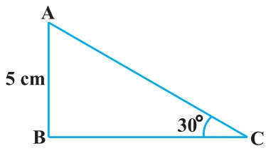

Table 8.1

|  A | 0° | 30° | 45° | 60° | 90° |
| --- | --- | --- | --- | --- | --- |
| sin A cos A tan A cosec A sec A cot A | 010Not defined1Not defined | 1232132233 | 12121221 | 3212323213 | 10Not defined1Not defined0 |

Remark : From the table above you can observe that as $\angle \mathrm { A }$ increases from $0 ^ { \circ }$ to $9 0 ^ { \circ }$ , sin A increases from 0 to 1 and cos A decreases from 1 to 0.

Let us illustrate the use of the values in the table above through some examples.

**Example 6 :** In $\Delta \mathrm { A B C }$ , right-angled at B, $\mathrm { A B }   =   5$ cm and $\angle ACB = 30^{\circ}$ (see Fig. 8.19). Determine the lengths of the sides BC and AC.

**Solution :** To find the length of the side BC, we will choose the trigonometric ratio involving BC and the given side AB. Since BC is the side adjacent to angle C and AB is the side opposite to angle C, therefore

Fig. 8.19

$$
{ \frac { \mathrm { A B } } { \mathrm { B C } } } = \tan \mathrm { C }
$$

i.e.,

$$
\frac{5}{BC} = \tan 30^{\circ} = \frac{1}{\sqrt{3}}
$$

which gives

$$
\mathrm{BC} = 5\sqrt{3}    cm
$$