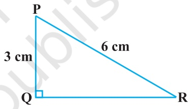

To find the length of the side AC, we consider

$$
\sin 3 0 ^ { \circ }   =   { \frac { \mathrm { A B } } { \mathrm { A C } } }
$$

$$
( \mathrm { W h y } ? )
$$

i.e.,

$$
{ \frac { 1 } { 2 } } \; = \; { \frac { 5 } { \mathrm { A C } } }
$$

i.e.,

$$
AC = 10    cm
$$

Note that alternatively we could have used Pythagoras theorem to determine the third side in the example above,

i.e.,

$$
\mathrm{AC} = \sqrt{\mathrm{AB}^{2} + \mathrm{BC}^{2}} = \sqrt{5^{2} + (5\sqrt{3})^{2}} \mathrm{cm} = 10\mathrm{cm}
$$

**Example 7 :** In   PQR, right-angled at

Q (see Fig. 8.20), $\mathrm { P Q } = 3$ cm and $\mathrm{PR} = 6\ \mathrm{cm}$

Determine $\angle \mathrm { Q P R }$ and $\angle \mathrm { P R Q }$

**Solution :** Given $\mathrm { P Q } = 3$ cm and $PR = 6   cm .$

Therefore,

$$
\frac{PQ}{PR} \approx \sin R
$$

Fig. 8.20

or

$$
\sin R = \frac{3}{6} = \frac{1}{2}
$$

So,

$$
\angle PRQ = 30^{\circ}
$$

and therefore,

$$
\angle  QPR = 60^{\circ}. \quad ( Why? )
$$

You may note that if one of the sides and any other part (either an acute angle or any side) of a right triangle is known, the remaining sides and angles of the triangle can be determined.

**Example 8 :** If sin $( \mathrm { A } - \mathrm { B } ) = \frac { 1 } { 2 } , \cos ( \mathrm { A } + \mathrm { B } ) = \frac { 1 } { 2 } , 0 ^ { \circ } < \mathrm { A } + \mathrm { B } \leq 9 0 ^ { \circ } , \mathrm { A } > \mathrm { B } .$ , find A and B.

**Solution :** Since, sin $( \mathrm { A } - \mathrm { B } ) = { \frac { 1 } { 2 } }$ , therefore, $\mathrm { A - B } = 3 0 ^ { \circ } \quad \mathrm { ( W h y ? ) }$

(1)

Also, since cos $( \mathbf { A } + \mathbf { B } ) = { \frac { 1 } { 2 } }$ , therefore, $\mathrm { A + B = 6 0 ^ { \circ } \quad ( W h y ? ) }$

(2)

Solving (1) and (2), we get : $\mathrm { A }   = 4 5 ^ { \circ }$ and $\mathbf { B } = 1 5 ^ { \circ }$