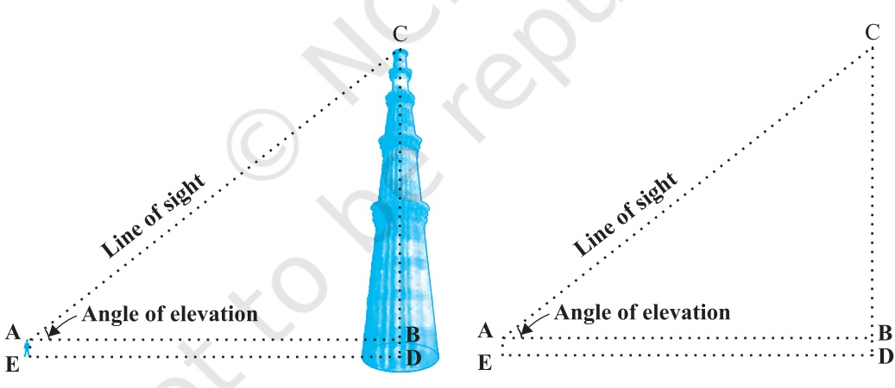

# SOME APPLICATIONS OF TRIGONOMETRY

## 9.1 Heights and Distances

**In the previous chapter, you have studied about trigonometric ratios. In this chapter, you will be studying about some ways in which trigonometry is used in the life around you.**

**Let us consider Fig. 8.1 of prvious chapter, which is redrawn below in Fig. 9.1.**

Fig. 9.1

**In this figure, the line AC drawn from the eye of the student to the top of the minar is called the** line of sight**. The student is looking at the top of the minar. The angle BAC, so formed by the line of sight with the horizontal, is called the** angle of elevation **of the top of the minar from the eye of the student.**

**Thus, the line of sight is the line drawn from the eye of an observer to the point in the object viewed by the observer. The angle of elevation of the point viewed is**