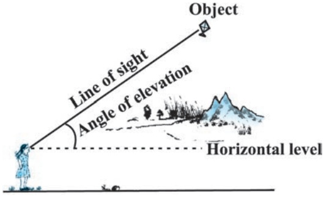
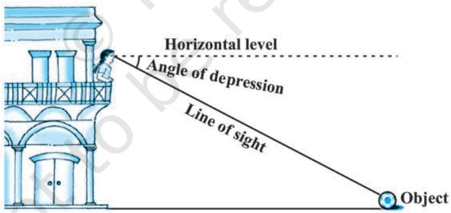

the angle formed by the line of sight with the horizontal when the point being viewed is above the horizontal level, i.e., the case when we raise our head to look at the object (see Fig. 9.2). Obiect

Fig. 9.2

Now, consider the situation given in Fig. 8.2. The girl sitting on the balcony is looking down at a flower pot placed on a stair of the temple. In this case, the line of sight is below the horizontal level. The angle so formed by the line of sight with the horizontal is called the angle of depression.

Thus, the **angle of depression** of a point on the object being viewed is the angle formed by the line of sight with the horizontal when the point is below the horizontal level, i.e., the case when we lower our head to look at the point being viewed (see Fig. 9.3).

Fig. 9.3

Now, you may identify the lines of sight, and the angles so formed in Fig. 8.3. Are they angles of elevation or angles of depression?

Let us refer to Fig. 9.1 again. If you want to find the height CD of the minar without actually measuring it, what information do you need? You would need to know the following:

(i) the distance DE at which the student is standing from the foot of the minar