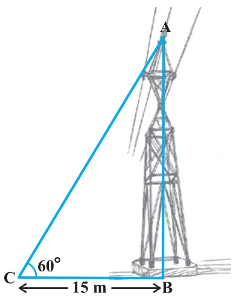

(ii) the angle of elevation, $\angle \mathrm { B A C }$ , of the top of the minar

(iii) the height AE of the student.

Assuming that the above three conditions are known, how can we determine the height of the minar?

In the figure, $\mathrm{CD} = \mathrm{CB} + \mathrm{BD}$ . Here, $\mathrm { B D } = \mathrm { A E }$ , which is the height of the student.

To find BC, we will use trigonometric ratios of $\angle \mathrm { B A C } \; \mathrm { o r } \; \angle \mathrm { A }$

In   ABC, the side BC is the opposite side in relation to the known $\mathrm { \angle A }$ . Now, which of the trigonometric ratios can we use? Which one of them has the two values that we have and the one we need to determine? Our search narrows down to using either tan A or cot A, as these ratios involve AB and BC.

Therefore, tan $\mathrm{A}=\frac{\mathrm{BC}}{\mathrm{AB}} \quad \text { or } \quad \cot \mathrm{A}=\frac{\mathrm{AB}}{\mathrm{BC}},$ ,  which on solving would give us BC.

By adding AE to BC, you will get the height of the minar.

Now let us explain the process, we have just discussed, by solving some problems.

**Example 1 :** A tower stands vertically on the ground. From a point on the ground, which is 15 m away from the foot of the tower, the angle of elevation of the top of the tower is found to be $6 0 ^ { \circ }$ . Find the height of the tower.

**Solution :** First let us draw a simple diagram to represent the problem (see Fig. 9.4). Here AB represents the tower, CB is the distance of the point from the tower and $\angle \mathrm { A C B }$ is the angle of elevation. We need to determine the height of the tower, i.e., AB. Also, ACB is a triangle, right- angled at B.

To solve the problem, we choose the trigonometric ratio tan $6 0 ^ { \circ }$ (or cot $6 0 ^ { \circ } )$ , as the ratio involves AB and BC.

Now,

$$
\tan 6 0 ^ { \circ } = { \frac { \mathrm { A B } } { \mathrm { B C } } }
$$

i.e.,

$$
\left[ \sqrt{3} \right. \left. = \right. \left. \frac{ AB }{15} \right.
$$

Fig. 9.4

i.e.,

$$
\mathrm{AB} = \overbrace{15\sqrt{3}}^{}
$$

Hence, the height of the tower is $1 5 { \sqrt { 3 } }$ m.