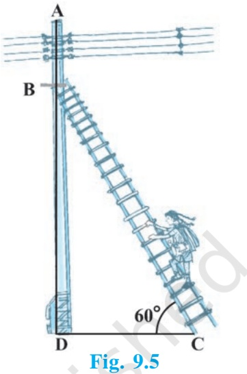

**Example 2 :** An electrician has to repair an electric fault on a pole of height 5 m. She needs to reach a point 1.3m below the top of the pole to undertake the repair work (see Fig. 9.5). What should be the length of the ladder that she should use which, when inclined at an angle of $6 0 ^ { \circ }$ to the horizontal, would enable her to reach the required position? Also, how far from the foot of the pole should she place the foot of the ladder? (You may take ${ \sqrt { 3 } } \; = 1 . 7 3 )$

**Solution :** In Fig. 9.5, the electrician is required to reach the point B on the pole AD.

So,

$$
\mathrm{BD} = \mathrm{AD} - \mathrm{AB} = (5 - 1.3) \mathrm{m} = 3.7 \mathrm{m}
$$

Here, BC represents the ladder. We need to find

its length, i.e., the hypotenuse of the right triangle BDC.

Now, can you think which trigonometic ratio should we consider?

It should be sin $6 0 ^ { \circ }$

So,

Therefore,

$$
\frac{\mathrm{BD}}{\mathrm{BC}}=\sin 60^{\circ} \text { or } \frac{3.7}{\mathrm{BC}}=\frac{\sqrt{3}}{2}
$$

i.e., the length of the ladder should be 4.28 m.

Now,

$$
\frac{\mathrm{DC}}{\mathrm{BD}} = \cot 60^{\circ} = \frac{1}{\sqrt{3}}
$$

i.e.,

$$
\mathrm{DC}=\frac{3.7}{\sqrt{3}}=2.14\mathrm{~m}\left(\mathrm{appears.}\right)
$$

Therefore, she should place the foot of the ladder at a distance of 2.14 m from the pole.