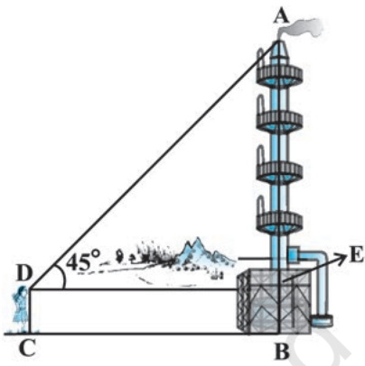

**Example 3 :** An observer 1.5 m tall is 28.5 m away from a chimney. The angle of elevation of the top of the chimney from her eyes is $4 5 ^ { \circ }$ . What is the height of the chimney?

**Solution :** Here, AB is the chimney, CD the observer and $\angle \mathrm { A D E }$ the angle of elevation (see Fig. 9.6). In this case, ADE is a triangle, right-angled at E and we are required to find the height of the chimney.

We have

$$
\mathrm{AB} = \mathrm{AE} + \mathrm{BE} = \mathrm{AE} + 1.5
$$

Fig. 9.6

and

$$
DE = CB = 28.5   m
$$

To determine AE, we choose a trigonometric ratio, which involves both AE and DE. Let us choose the tangent of the angle of elevation.

Now,

$$
\tan 45^{\circ} = \frac{ AE }{ DE }
$$

i.e.,

$$
1 \equiv \frac{AE}{28.5}
$$

Therefore,

$$
\mathrm { A E } = 2 8 . 5
$$

So the height of the chimney $(AB) = (28.5 + 1.5)    m  = 30    m$

**Example 4 :** From a point P on the ground the angle of elevation of the top of a 10 m tall building is $3 0 ^ { \circ }$ . A flag is hoisted at the top of the building and the angle of elevation of the top of the flagstaff from P is $4 5 ^ { \circ }$ . Find the length of the flagstaff and the distance of the building from the point P. (You may take ${ \sqrt { 3 } }   = 1 . 7 3 2 )$

**Solution :** In Fig. 9.7, AB denotes the height of the building, BD the flagstaff and P the given point. Note that there are two right triangles PAB and PAD. We are required to find the length of the flagstaff, i.e., DB and the distance of the building from the point P, i.e., PA.