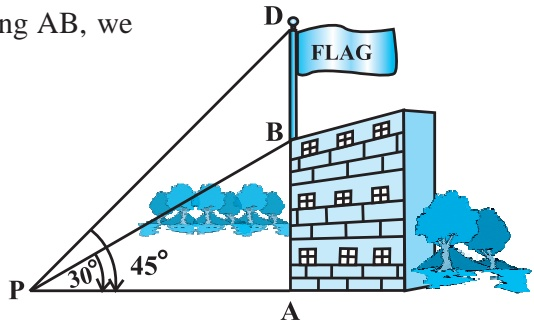
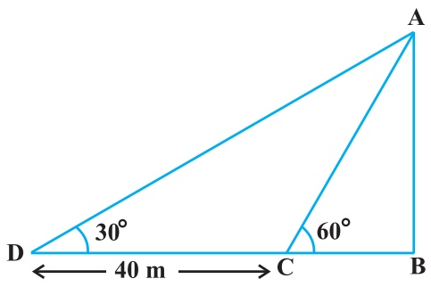

Since, we know the height of the building AB, we will first consider the right $\Delta   \mathrm { P A B }$

We have

$$
\tan 3 0 ^ { \circ } = { \frac { \mathrm { A B } } { \mathrm { A P } } }
$$

i.e.,

$$
{ \frac { 1 } { \sqrt { 3 } } } \; = \; { \frac { 1 0 } { \mathrm { A P } } }
$$

Therefore,

$$
\mathrm { A P } = { \stackrel { \cdot } { 1 0 { \sqrt { 3 } } } }
$$

Fig. 9.7

i.e., the distance of the building from P is $10\sqrt{3}\  m =17.32\  m .$

Next, let us suppose $\mathrm { D B } = x   \mathrm { m }$ . Then $\mathrm{AD} = (10 + x)   \mathrm{m}$

Now, in right   PAD,

$$
\tan 45^{\circ} = \frac{ AD }{ AP } = \frac{10 \mp x}{10\sqrt{3}}
$$

Therefore,

$$
\frac{10 + x}{10\sqrt{3}}
$$

i.e.,

$$
x = 10 \left( \sqrt{3} - 1 \right) = 7.32
$$

$\mathrm { S o } ,$ the length of the flagstaff is 7.32 m.

**Example 5 :** The shadow of a tower standing on a level ground is found to be 40 m longer when the Sun’s altitude is $3 0 ^ { \circ }$ than when it is $6 0 ^ { \circ }$ . Find the height of the tower.

**Solution :** In Fig. 9.8, AB is the tower and BC is the length of the shadow when the $\mathrm { S u n } ^ { \mathrm { { \textquotesingle } } } \mathrm { s }$ altitude is $6 0 ^ { \circ }$ , i.e., the angle of elevation of the top of the tower from the tip of the shadow is $6 0 ^ { \circ }$ and DB is the length of the shadow, when the angle of elevation is $3 0 ^ { \circ }$

Fig. 9.8

Now, let AB be h m and BC be x m. According to the question, DB is 40 m longer than BC.