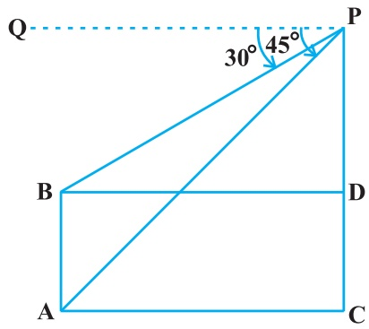

So,

$$
DB  = (40 + x)  m
$$

Now, we have two right triangles ABC and ABD.

In   ABC,

$$
\tan 6 0 ^ { \circ } = { \frac { \mathrm { A B } } { \mathrm { B C } } }
$$

or,

$$
\left[ \sqrt{3} \right. = \left. \frac{h}{x} \right.\tag{1}
$$

In   ABD,

$$
\tan 3 0 ^ { \circ } = { \frac { \mathrm { A B } } { \mathrm { B D } } }
$$

i.e.,

$$
\left[ { \frac { 1 } { \sqrt { 3 } } } \; = \; { \frac { h } { x   +   4 0 } } \right]\tag{2}
$$

From (1), we have

$$
h = { \stackrel { \cdot } { x } } { \sqrt { 3 } }
$$

Putting this value in (2), we get $\left( x \sqrt { 3 } \right) \sqrt { 3 } = x + 4 0 , \mathrm { i . e . } , 3 x = x + 4 0$

i.e.,

$$
x = \: 2 0
$$

So,

$$
h = 20\sqrt{3}\tag{[From (1)]}
$$

Therefore, the height of the tower is $\overline { { 2 0 } } \sqrt { 3 }$ m.

**Example 6 :** The angles of depression of the top and the bottom of an 8 m tall building from the top of a multi-storeyed building are $3 0 ^ { \circ }$ and $4 5 ^ { \circ }$ , respectively. Find the height of the multi-storeyed building and the distance between the two buildings.

**Solution :** In Fig. 9.9, PC denotes the multi-storyed building and AB denotes the 8 m tall building. We are interested to determine the height of the multi-storeyed building, i.e., PC and the distance between the two buildings, i.e., AC.

Look at the figure carefully. Observe that PB is a transversal to the parallel lines PQ and BD. Therefore, $\angle  QPB$ and $\angle \mathrm { P B D }$ are alternate angles, and so are equal. $\mathrm{So} \angle \mathrm{PBD} = 30^{\circ}$ . Similarly, $\angle  PAC = 45^{\circ}$ In right   PBD, we have

Fig. 9.9