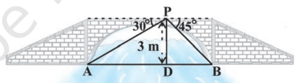

$$
\frac{\mathrm{PD}}{\mathrm{BD}} = \tan 30^{\circ} = \frac{1}{\sqrt{3}} \quad  or  \quad \mathrm{BD} = \mathrm{PD} \sqrt{3}
$$

In right $\Delta \; \mathrm { P A C }$ , we have

$$
\frac{PC}{AC} = \tan 45^{\circ} = 1
$$

i.e.,

Also,

$$
\begin{aligned} & PC  =  AC  \\& PC  =  PD  +  DC ,  therefore ,  PD  +  DC  =  AC .\\ \end{aligned}
$$

Since, $\mathrm { A C } = \mathrm { B D }$ and $\mathrm{DC} = \mathrm{AB} = 8$ m, we get $PD + 8 = BD = PD\sqrt{3} (\text{Why?})$

This gives

$$
\mathrm{PD} = \frac{8}{\sqrt{3} - 1} = \frac{8\left( \sqrt{3} + 1 \right)}{\left( \sqrt{3} + 1 \right)\left( \sqrt{3} - 1 \right)} = 4\left( \sqrt{3} + 1 \right)\mathrm{m}.
$$

$\mathrm { S o } ,$ the height of the multi-storeyed building is $\left\{ 4\left( \sqrt{3} + 1 \right) + 8 \right\} = 4\left( 3 + \sqrt{3} \right)$ m and the distance between the two buildings is also $4(3 + \sqrt{3})  m$

**Example 7 :** From a point on a bridge across a river, the angles of depression of the banks on opposite sides of the river are $3 0 ^ { \circ }$ and $4 5 ^ { \circ }$ , respectively. If the bridge is at a height of 3 m from the banks, find the width of the river.

**Solution :** In Fig 9.10, A and B represent points on the bank on opposite sides of the river, so that AB is the width of the river. P is a point on the bridge at a height of 3 m , i . e . , $\mathrm { D P } = 3 \mathrm { ~ m } .$ We are interested to determine the width of the river, which is the length of the side AB of the D APB.

Fig. 9.10

Now,

$$
\mathrm{AB} = \mathrm{AD} + \mathrm{DB}
$$

In right $\Delta  APD , \angle  A = 30^{\circ}$

So,

$$
\tan   30^{\circ}   =   \frac{ PD }{ AD }
$$