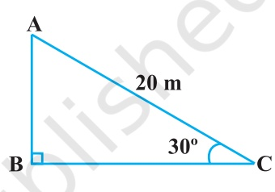

i.e.,

$$
\frac{1}{\sqrt{3}} = \frac{3}{AD}  or   AD = 3\sqrt{3}  m
$$

Also, in right $\Delta$ PBD, $\angle \mathbf { B } = 4 5 ^ { \circ }$ . So, BD = PD = 3 m.

Now,

$$
AB = BD + AD = 3 + 3\sqrt{3} = 3\left(1 + \sqrt{3}\right) m.
$$

Therefore, the width of the river is $3 \left( { \sqrt { 3 } } + 1 \right)   \mathrm { m }$

## EXERCISE 9.1

**1.** A circus artist is climbing a 20 m long rope, which is tightly stretched and tied from the top of a vertical pole to the ground. Find the height of the pole, if the angle made by the rope with the ground level is $3 0 ^ { \circ }$ (see Fig. 9.11).

**2.** A tree breaks due to storm and the broken part bends so that the top of the tree touches the ground making an angle $3 0 ^ { \circ }$ with it. The distance between the foot of the tree to the point where the top touches the ground is 8 m. Find the height of the tree.

Fig. 9.11

**3.** A contractor plans to install two slides for the children to play in a park. For the children below the age of 5 years, she prefers to have a slide whose top is at a height of 1.5 m, and is inclined at an angle of $3 0 ^ { \circ }$ to the ground, whereas for elder children, she wants to have a steep slide at a height of $3   \mathrm { m } ,$ and inclined at an angle of $6 0 ^ { \circ }$ to the ground. What should be the length of the slide in each case?

**4.** The angle of elevation of the top of a tower from a point on the ground, which is 30 m away from the foot of the tower, is $3 0 ^ { \circ }$ . Find the height of the tower.

**5.** A kite is flying at a height of 60 m above the ground. The string attached to the kite is temporarily tied to a point on the ground. The inclination of the string with the ground is $6 0 ^ { \circ } .$ . Find the length of the string, assuming that there is no slack in the string.

**6.** A 1.5 m tall boy is standing at some distance from a 30 m tall building. The angle of elevation from his eyes to the top of the building increases from $3 0 ^ { \circ }$ to $6 0 ^ { \circ }$ as he walks towards the building. Find the distance he walked towards the building.

**7.** From a point on the ground, the angles of elevation of the bottom and the top of a transmission tower fixed at the top of a 20 m high building are $4 5 ^ { \circ }$ and $6 0 ^ { \circ }$ respectively. Find the height of the tower.