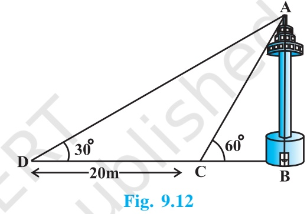
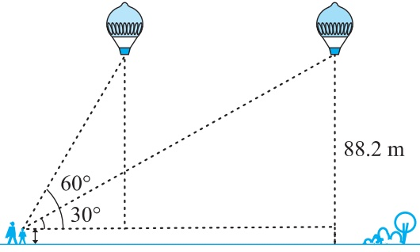

**8.** A statue, 1.6 m tall, stands on the top of a pedestal. From a point on the ground, the angle of elevation of the top of the statue is $6 0 ^ { \circ }$ and from the same point the angle of elevation of the top of the pedestal is $4 5 ^ { \circ }$ . Find the height of the pedestal.

**9.** The angle of elevation of the top of a building from the foot of the tower is $3 0 ^ { \circ }$ and the angle of elevation of the top of the tower from the foot of the building is $6 0 ^ { \circ }$ . If the tower is 50 m high, find the height of the building.

**10.** Two poles of equal heights are standing opposite each other on either side of the road, which is 80 m wide. From a point between them on the road, the angles of elevation of the top of the poles are $6 0 ^ { \circ }$ and $3 0 ^ { \circ }$ , respectively. Find the height of the poles and the distances of the point from the poles. A

**11.** A TV tower stands vertically on a bank of a canal. From a point on the other bank directly opposite the tower, the angle of elevation of the top of the tower is $6 0 ^ { \circ }$ . From another point 20 m away from this point on the line joing this point to the foot of the tower, the angle of elevation of the top of the tower is $3 0 ^ { \circ }$ (see Fig. 9.12). Find the height of the tower and the width of the canal.

**12.** From the top of a 7 m high building, the angle of elevation of the top of a cable tower is $6 0 ^ { \circ }$ and the angle of depression of its foot is $4 5 ^ { \circ } .$ Determine the height of the tower.

**13.** As observed from the top of a 75 m high lighthouse from the sea-level, the angles of depression of two ships are $3 0 ^ { \circ }$ and $4 5 ^ { \circ }$ . If one ship is exactly behind the other on the same side of the lighthouse, find the distance between the two ships.

**14.** A 1.2 m tall girl spots a balloon moving with the wind in a horizontal line at a height of 88.2 m from the ground. The angle of elevation of the balloon from the eyes of the girl at any instant is $6 0 ^ { \circ }$ . After some time, the angle of elevation reduces to $3 0 ^ { \circ }$ (see Fig. 9.13). Find the distance travelled by the balloon during the interval.

Fig. 9.13

**15.** A straight highway leads to the foot of a tower. A man standing at the top of the tower observes a car at an angle of depression of $3 0 ^ { \circ }$ , which is approaching the foot of the