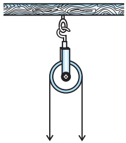
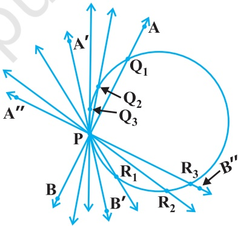

You might have seen a pulley fitted over a well which is used in taking out water from the well. Look at Fig. 10.2. Here the rope on both sides of the pulley, if considered as a ray, is like a tangent to the circle representing the pulley.

Is there any position of the line with respect to the circle other than the types given above? You can see that there cannot be any other type of position of the line with respect to the circle. In this chapter, we will study about the existence of the tangents to a circle and also study some of their properties.

Fig. 10.2

## 10.2 Tangent to a Circle

**intersects the circle at only one point**.

To understand the existence of the tangent to a circle at a point, let us perform the following activities:

**Activity 1 :** Take a circular wire and attach a straight wire AB at a point P of the circular wire so that it can rotate about the point P in a plane. Put the system on a table and gently rotate the wire AB about the point P to get different positions of the straight

In various positions, the wire intersects the circular wire at P and at another point $\mathbf { Q } _ { 1 }$ or $\mathbb { Q } _ { 2 }$ or $\mathbf { Q } _ { 3 } ,$ etc. In one position, you will see that it will intersect the circle at the point P only (see position $\mathbf { A ^ { \prime } B ^ { \prime } }$ of AB). This shows that a tangent exists at the point P of the circle. On rotating further, you can observe that in all other positions of AB, it will intersect the circle at P and at another point, say $\mathtt { R _ { 1 } }$ or $\mathtt { R } _ { 2 }$ or $\mathbb { R } _ { 3 } ,$ etc. So, you can observe that **there is only one tangent at a point of the circle**.

Fig. 10.3 (i)

While doing activity above, you must have observed that as the position AB moves towards the position $\mathrm { A ^ { \prime } \: B ^ { \prime } }$ , the common point, say $\mathbf { Q } _ { 1 }$ , of the line AB and the circle gradually comes nearer and nearer to the common point P. Ultimately, it coincides with the point P in the position $\mathrm { A ^ { \prime } B ^ { \prime } }$ of $\mathrm { A ^ { \prime \prime } B ^ { \prime \prime } }$ . Again note, what happens if $\mathrm { { ^ \circ } A B ^ { \prime } }$ is rotated rightwards about P? The common point $\mathtt { R } _ { 3 }$ gradually comes nearer and nearer to P and ultimately coincides with P. So, what we see is:

**The tangent to a circle is a special case of the secant, when the two end points of its corresponding chord coincide**.

<small>\*The word ‘tangent’ comes from the Latin word ‘tangere’, which means to touch and was introduced by the Danish mathematician Thomas Fineke in 1583.</small>