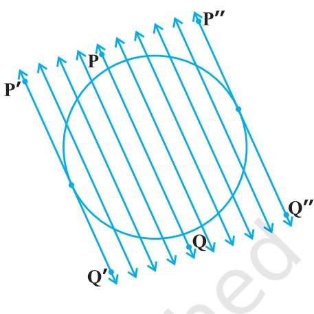
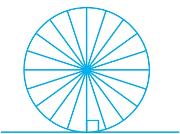

**Activity 2 :** On a paper, draw a circle and a secant PQ of the circle. Draw various lines parallel to the secant on both sides of it. You will find that after some steps, the length of the chord cut by the lines will gradually decrease, i.e., the two points of intersection of the line and the circle are coming closer and closer [see Fig. 10.3(ii)]. In one case, it becomes zero on one side of the secant and in another case, it becomes zero on the other side of the secant. See the positions $\mathrm { P ^ { \prime } Q ^ { \prime } }$ and $\mathrm { P ^ { \prime \prime } Q ^ { \prime \prime } }$ of the secant in Fig. 10.3 (ii). These are the tangents to the circle parallel to the given secant PQ. This also helps you to see that there cannot be more than two tangents parallel to a given secant.

Fig. 10.3 (ii)

This activity also establishes, what you must have observed, while doing Activity 1, namely, a tangent is the secant when both of the end points of the corresponding chord coincide.

The common point of the tangent and the circle is called the **point of contact** [the point A in Fig. 10.1 (iii)]and the tangent is said to **touch** the circle at the common point.

Now look around you. Have you seen a bicycle or a cart moving? Look at its wheels. All the spokes of a wheel are along its radii. Now note the position of the wheel with respect to its movement on the ground. Do you see any tangent anywhere? (See Fig. 10.4). In fact, the wheel moves along a line which is a tangent to the circle representing the wheel. Also, notice that in all positions, the radius through the point of contact with the ground appears to be at right angles to the tangent (see Fig. 10.4). We shall now prove this property of the tangent.

Fig. 10.4

**Theorem 10.1 :** The tangent at any point of a circle is perpendicular to the radius through the point of contact.

**Proof :** We are given a circle with centre O and a tangent XY to the circle at a point P. We need to prove that OP is perpendicular to XY.