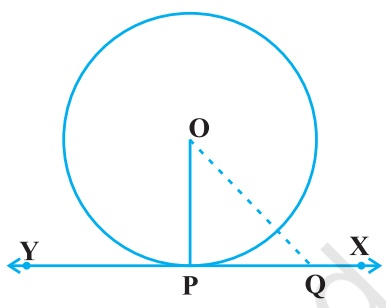

**Take a point Q on XY other than P and join OQ (see Fig. 10.5).**

**The point Q must lie outside the circle. (Why? Note that if Q lies inside the circle, XY will become a secant and not a tangent to the circle). Therefore, OQ is longer than the radius OP of the circle. That is,**

$$
\mathrm { O Q } > \mathrm { O P } .
$$

**Since this happens for every point on the line XY except the point P, OP is the shortest of all the distances of the point O to the points of XY. So OP is perpendicular to XY. (as shown in Theorem A1.7.)**

Fig. 10.5

## Remarks

**1. By theorem above, we can also conclude that at any point on a circle there can be one and only one tangent.**

**2. The line containing the radius through the point of contact is also sometimes called the ‘normal’ to the circle at the point.**

## EXERCISE 10.1

**1. How many tangents can a circle have?**

**2. Fill in the blanks :**

**(i) A tangent to a circle intersects it in point (s).**

**(ii) A line intersecting a circle in two points is called a**

**(iii) A circle can have parallel tangents at the most.**

**(iv) The common point of a tangent to a circle and the circle is called**

**3. A tangent PQ at a point P of a circle of radius 5 cm meets a line through the centre O at a point Q so that OQ = 12 cm. Length PQ is : (A) 12 cm (B) 13 cm (C) 8.5 cm (D)** $\left[ { \sqrt { 1 1 9 } } { \mathrm { ~ c m . } } \right.$

**4. Draw a circle and two lines parallel to a given line such that one is a tangent and the other, a secant to the circle.**

## 10.3 Number of Tangents from a Point on a Circle

**To get an idea of the number of tangents from a point on a circle, let us perform the following activity:**