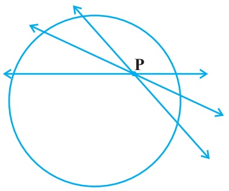
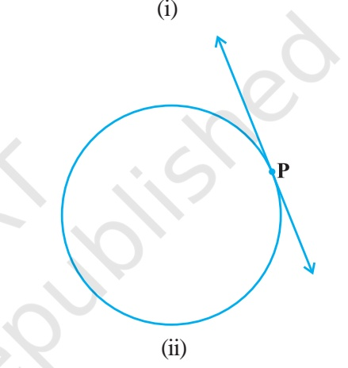
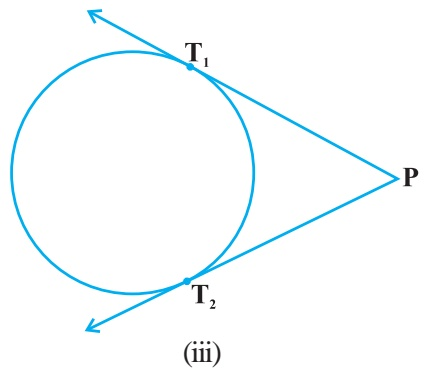

**Activity 3 :** Draw a circle on a paper. Take a point P inside it. Can you draw a tangent to the circle through this point? You will find that all the lines through this point intersect the circle in two points. So, it is not possible to draw any tangent to a circle through a point inside it [see Fig. 10.6 (i)].

Next take a point P on the circle and draw tangents through this point. You have already observed that there is only one tangent to the circle at such a point [see Fig. 10.6 (ii)].

Finally, take a point P outside the circle and try to draw tangents to the circle from this point. What do you observe? You will find that you can draw exactly two tangents to the circle through this point [see Fig. 10.6 (iii)].

We can summarise these facts as follows:

**Case 1 :** There is no tangent to a circle passing through a point lying inside the circle.

**Case 2 :** There is one and only one tangent to a circle passing through a point lying on the circle.

**Case 3 :** There are exactly two tangents to a circle through a point lying outside the circle.

In Fig. 10.6 (iii), $\mathrm{T_{1}andT_{2}}$ are the points of contact of the tangents $\mathrm { P T _ { 1 } }$ and $\mathrm { P T } _ { 2 }$ respectively.

The length of the segment of the tangent from the external point P and the point of contact with the circle is called the **length of the tangent** from the point P to the circle.

Fig. 10.6

Note that in Fig. 10.6 (iii), $\mathrm { P T } _ { 1 }$ and $\mathrm { P T } _ { 2 }$ are the lengths of the tangents from P to the circle. The lengths $\mathrm { P T } _ { 1 }$ and $\mathrm { P T } _ { 2 }$ have a common property. Can you find this? Measure $\mathrm { P T } _ { 1 }$ and $\mathrm { P T } _ { 2 ^ { \bullet } }$ Are these equal? In fact, this is always so. Let us give a proof of this fact in the following theorem.