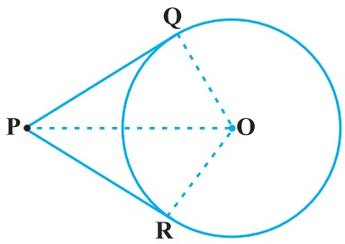
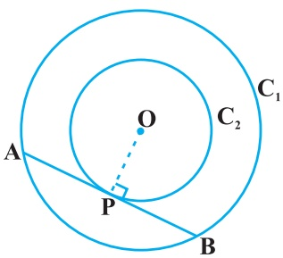

**Theorem 10.2 :** The lengths of tangents drawn from an external point to a circle are equal.

**Proof : We are given a circle with centre O, a point P lying outside the circle and two tangents PQ, PR on the circle from P (see Fig. 10.7). We** are required to prove that $\mathrm { P Q } = \mathrm { P R }$

**For this, we join OP, OQ and OR. Then** $\angle \mathrm { O Q P }$ **and** $\angle  ORP$ **are right angles, because these are angles between the radii and tangents, and according to Theorem 10.1 they are right angles. Now in right triangles OQP and ORP,**

Fig. 10.7

(Radii of the same circle)

$$
\mathrm { O Q = O R }
$$

$$
\mathrm { O P } = \mathrm { O P }
$$

**(Common)**

**Therefore,**

$$
\Delta \mathrm { \scriptsize ~ O Q P } \cong \Delta \mathrm { \scriptsize ~ O R P }\tag{RHS}
$$

**This gives**

$$
\mathrm{PQ} = \mathrm{PR}\tag{CPCT}
$$

## Remarks

**1. The theorem can also be proved by using the Pythagoras Theorem as follows:**

$$
\mathrm{PQ}^{2}=\mathrm{OP}^{2}-\mathrm{O} \mathrm{Q}^{2}=\mathrm{OP}^{2}-\mathrm{OR}^{2}=\mathrm{PR}^{2} \text { (As OQ=OR) }
$$

**which gives PQ = PR.**

**2. Note also that** $\angle OPQ = \angle OPR$ Therefore, OP is the angle bisector of $\angle \mathrm { Q P R }$ **i.e., the centre lies on the bisector of the angle between the two tangents.**

**Let us take some examples.**

**Example 1 : Prove that in two concentric circles, the chord of the larger circle, which touches the smaller circle, is bisected at the point of contact.**

**Solution : We are given two concentric circles** $\mathbf { C } _ { \mathrm { i } }$ and $\mathbf { C } _ { 2 }$ **with centre O and a chord AB of the** larger circle $\mathrm{C}_{1}$ **which touches the smaller circle** $\mathbf { C } _ { z }$ **at the point** $\mathrm { P }$ **(see Fig. 10.8). We need to prove** that $\mathrm { A P } = \mathrm { B P } .$

Let us join OP. Then, AB is a tangent to $\mathbf { C } _ { 2 }$ **at P and OP is its radius. Therefore, by Theorem 10.1,**

$$
\mathrm { O P \perp A B }
$$

Fig. 10.8