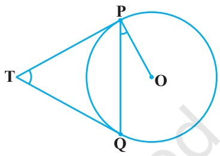
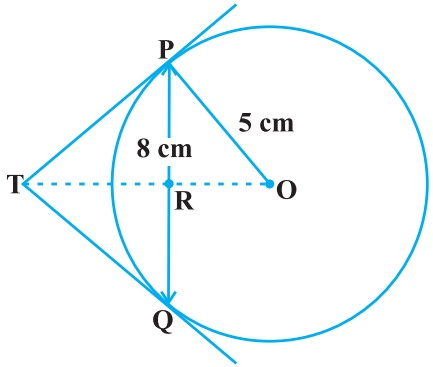

Now AB is a chord of the circle $\mathbf { C } _ { \mathrm { i } }$ and $\mathrm { O P \bot A B }$ . Therefore, OP is the bisector of the chord AB, as the perpendicular from the centre bisects the chord,

i.e.,

$$
\mathrm { A P } = \mathrm { B P }
$$

Example 2 : Two tangents TP and TQ are drawn to a circle with centre O from an external point T. Prove that $\angle PTQ = 2 \angle OPQ$

Solution : We are given a circle with centre O, an external point T and two tangents TP and TQ to the circle, where P, Q are the points of contact (see Fig. 10.9). We need to prove that

$$
\angle PTQ = 2 \angle OPQ
$$

Fig. 10.9

Let

$$
\angle \mathrm{PTQ} = \theta
$$

Now, by Theorem 10.2, $\mathrm { T P }   =   \mathrm { T Q } .$ So, TPQ is an isosceles triangle.

Therefore,

$$
\angle TPQ = \angle TPP = \frac{1}{2}(180^{\circ} - \theta) = 90^{\circ} - \frac{1}{2}\theta
$$

Also, by Theorem 10.1,

$$
\angle  OPT = 90^{\circ}
$$

So,

$$
\angle OPQ = \angle OPT - \angle TPQ = 90^{\circ} - \left(90^{\circ} - \frac{1}{2}\theta\right)
$$

$$
\frac{1}{2} \Theta = \frac{1}{2} \angle \mathrm{PTQ}
$$

This gives

$$
\angle PTQ = 2 \angle OPQ
$$

Example 3 : PQ is a chord of length 8 cm of a circle of radius 5 cm. The tangents at P and Q intersect at a point T (see Fig. 10.10). Find the length TP.

Solution : Join OT. Let it intersect PQ at the point R. Then ∆ TPQ is isosceles and TO is the angle bisector of $\angle   \mathrm { { \Large ~ P T Q } }$ . So, OT ⊥ PQ and therefore, OT bisects PQ which gives $\mathrm{PR} = \mathrm{RQ} = 4\mathrm{cm}$

Fig. 10.10

Also, $\mathrm{OR}=\sqrt{\mathrm{OP}^{2}-\mathrm{PR}^{2}}=\sqrt{5^{2}-4^{2}} \mathrm{cm}=3 \mathrm{cm}$