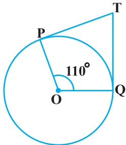

Now, $\angle TPR  + \angle RPO = 90^{\circ} = \angle TPR  + \angle PTR$

So, $\angle  RPO  = \angle  PTR$

Therefore, right triangle TRP is similar to the right triangle PRO by AA similarity.

This gives

$$
\frac{ TP }{ PO } = \frac{ RP }{ RO },  i.e., \frac{ TP }{5} = \frac{4}{3}  or   TP  = \frac{20}{3}  cm .
$$

**Note :** TP can also be found by using the Pythagoras Theorem, as follows:

Let

$$
\mathrm{TP} = x \quad  and  \quad \mathrm{TR} = y. \quad \mathrm{Then}
$$

$$
x ^ { 2 } = y ^ { 2 } + 1 6 \qquad \mathrm { ( T a k i n g ~ r i g h t ~ \Delta ~ P R T ) }\tag{1}
$$

$$
x ^ { 2 } + 5 ^ { 2 } = ( y + 3 ) ^ { 2 } \qquad \mathrm { ( T a k i n g ~ r i g h t ~ \Delta ~ O P T ) }\tag{2}
$$

Subtracting (1) from (2), we get

$$
25 = 6y - 7 \quad  or  \quad y = \frac{32}{6} = \frac{16}{3}
$$

Therefore,

$$
x^{2}=\left(\frac{16}{3}\right)^{2}+16=\frac{16}{9}(16+9)=\frac{16\times25}{9}
$$

[From (1)]

or

$$
x = \frac{20}{3}
$$

## EXERCISE 10.2

In Q.1 to 3, choose the correct option and give justification.

. rom a po nt Q, t e engt o t e tangent to a c rcle is 24 cm and the distance of Q from 1 F i h l h f h i the centre is 25 cm. The radius of the circle is (A) 7 cm (B) 12 cm (C) 15 cm (D) 24.5 cm

**2.** In Fig. 10.11, if TP and TQ are the two tangents to a circle with centre O so that $\angle POQ = 110^{\circ}$ then $\angle \mathrm{PTQ}$ is equal to (A) $6 0 ^ { \circ }$ (B) $7 0 ^ { \circ }$ (C) $8 0 ^ { \circ }$ (D) $9 0 ^ { \circ }$

Fig. 10.11

**3.** If tangents PA and PB from a point P to a circle with centre O are inclined to each other at angle of $8 0 ^ { \circ }$ , then $\angle \mathrm { P O A }$ is equal to (A) $5 0 ^ { \circ }$ (B) $6 0 ^ { \circ }$ (C) $7 0 ^ { \circ }$ (D) $8 0 ^ { \circ }$