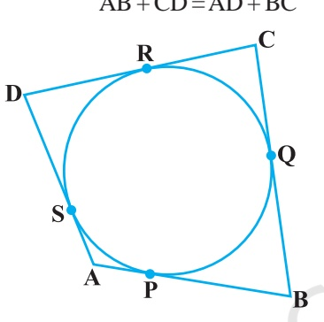
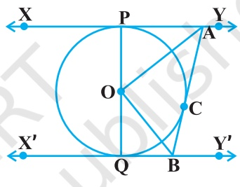
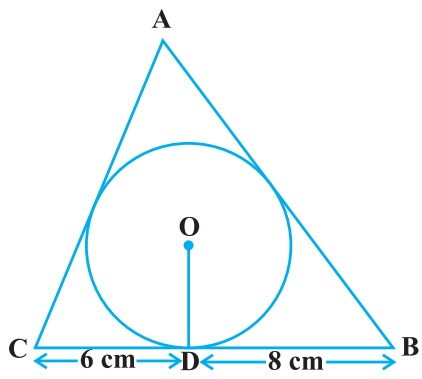

**4.** Prove that the tangents drawn at the ends of a diameter of a circle are parallel.

**5.** Prove that the perpendicular at the point of contact to the tangent to a circle passes through the centre.

**6.** The length of a tangent from a point A at distance 5 cm from the centre of the circle is 4 cm. Find the radius of the circle.

**7.** Two concentric circles are of radii 5 cm and 3 cm. Find the length of the chord of the larger circle which touches the smaller circle.

**8.** A quadrilateral ABCD is drawn to circumscribe a circle (see Fig. 10.12). Prove that

Fig. 10.12

Fig. 10.13

**9.** In Fig. 10.13, XY and X Y  are two parallel tangents to a circle with centre O and another tangent AB with point of contact C intersecting XY at A and $\mathrm { X ^ { \prime } Y ^ { \prime } }$ at B. Prove that $\angle AOB = 90^{\circ}$

**10.** Prove that the angle between the two tangents drawn from an external point to a circle contact at the centre.

**11.** Prove that the parallelogram circumscribing a circle is a rhombus.

**12.** A triangle ABC is drawn to circumscribe a circle of radius 4 cm such that the segments BD and DC into which BC is divided by the point of contact D are of lengths 8 cm and 6 cm respectively (see Fig. 10.14). Find the sides AB and AC.

**13.** Prove that opposite sides of a quadrilateral circumscribing a circle subtend supplementary angles at the centre of the circle.

Fig. 10.14