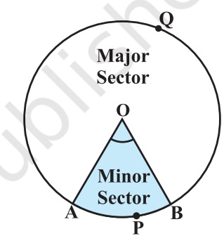
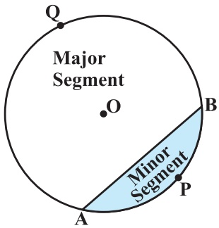

# AREAS RELATED TO CIRCLES

## 11.1 Areas of Sector and Segment of a Circle

**You have already come across the terms** sector **and** segment **of a circle in your earlier classes. Recall that the portion (or part) of the circular region enclosed by two radii and the corresponding arc is called a** sector **of the circle and the portion (or part) of the circular region enclosed between a chord and the corresponding arc is called a** segment **of the circle. Thus, in Fig. 11.1, shaded region OAPB is a** sector **of the circle with centre** $O. $\angle \mathrm{AOB}$$ **is called the**

Fig. 11.1

angle **of the sector. Note that in this figure, unshaded region OAQB is also a sector of the circle. For obvious reasons, OAPB is called the** minor sector **and OAQB is called the** major sector**. You can also see that angle of the major sector is** $3 6 0 ^ { \circ } - \angle \mathrm { A O B }$

**Now, look at Fig. 11.2 in which AB is a chord of the circle with centre O. So, shaded region APB is a segment of the circle. You can also note that unshaded region AQB is another segment of the circle formed by the chord AB. For obvious reasons, APB is called the** minor segment **and AQB is called the** major segment.

Remark : When we write ‘segment’ and ‘sector **we will mean the ‘minor segment’ and the ‘minor sector’ respectively, unless stated otherwise.**

Fig. 11.2