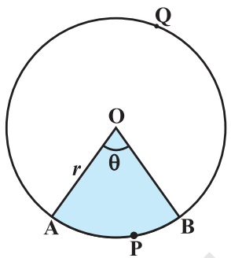
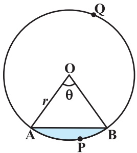

**Now with this knowledge, let us try to find some relations (or formulae) to calculate their areas.**

**Let OAPB be a sector of a circle with centre O and radius** r **(see Fig. 11.3). Let the degree measure of** $\angle \mathrm { A O B }$ **be** q.

**You know that area of a circle (in fact of a circular region or disc) is** $元  r^{2}$

**In a way, we can consider this circular region to be a sector forming an angle of** $3 6 0 ^ { \circ }$ **(i.e., of degree measure 360) at the centre O. Now by applying the Unitary Method, we can arrive at the area of the sector OAPB as follows:**

Fig. 11.3

**When degree measure of the angle at the centre is 360, area of the** sector $\iota = \pi r ^ { 2 }$

**So, when the degree measure of the angle at the centre is 1, area of the** $\mathtt { s e c t o r } = { \frac { \pi r ^ { 2 } } { 3 6 0 } }$

**Therefore, when the degree measure of the angle at the centre is** q**, area of the** $\mathrm{sector} = \frac{\pi r^{2}}{360} \times \theta = \frac{\theta}{360} \times \pi r^{2}$

**Thus, we obtain the following relation (or formula) for area of a sector of a circle:**

**Area of the sector of angle** $\theta = \frac{\theta}{360} \times \pi r^{2}$

**where** r **is the radius of the circle and** q **the angle of the sector in degrees.**

**Now, a natural question arises : Can we find the length of the arc APB corresponding to this sector? Yes. Again, by applying the Unitary Method and taking the whole length of the circle (of angle 360°) as 2**pr**, we can obtain the required length of the arc APB as** $\frac { \theta } { 3 6 0 } \times 2 \pi r$

**So, length of an arc of a sector of angle** $\Theta = \frac{\Theta}{360} \times 2 \pi r$

Fig. 11.4