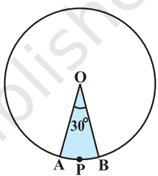

Now let us take the case of the area of the segment APB of a circle with centre O and radius r

(see Fig. 11.4). You can see that :

Area of the segment APB = Area of the sector OAPB – Area of   OAB

$$
\frac{\theta}{360} \times \pi r^{2} -  area of   \Delta  OAB
$$

**Note :** From Fig. 11.3 and Fig. 11.4 respectively, you can observe that:

Area of the major sector $\mathrm { O A Q B } = \pi r ^ { 2 } - \mathrm { A r e a }$ of the minor sector OAPB and Area of major segment $\mathrm { A Q B } = \pi r ^ { 2 }$ – Area of the minor segment APB Let us now take some examples to understand these concepts (or results).

**Example 1 :** Find the area of the sector of a circle with radius 4 cm and of angle 30°. Also, find the area of the corresponding major sector (Use   = 3.14).

**Solution :** Given sector is OAPB (see Fig. 11.5).

2 Area of the sector = ×πr 360 30 ×3.14×4×4cm² 360 12.56 2 2 cm 4.19cm  (approx.) 3

Fig. 11.5

Area of the corresponding major sector

$$
\begin{aligned} &= \pi r^{2} -  area of sector OAPB  \\&= (3.14 \times 16 - 4.19)  cm ^{2} \\&= 46.05  cm ^{2} = 46.1  cm ^{2} ( approach. )\\ \end{aligned}
$$

**Alternatively,** area of the major se $\begin{aligned}\operatorname{factor} &= \frac{(360 - \theta)}{360} \times \pi r^{2} \\&= \left( \frac{360 - 30}{360} \right) \times 3.14 \times 16 \operatorname{cm}^{2} \\&= \frac{330}{360} \times 3.14 \times 16 \operatorname{cm}^{2} = 46.05 \operatorname{cm}^{2} \\&= 46.1 \operatorname{cm}^{2} (\operatorname{apprcx.})\end{aligned}$