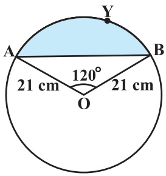
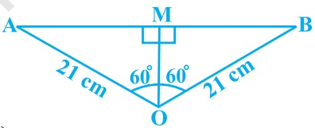

Example 2 : Find the area of the segment AYB shown in Fig. 11.6, if radius of the circle is 21 cm and

$$
\angle  AOB = 120^{\circ}. (Use \pi = \frac{22}{7})
$$

Fig. 11.6

Solution : Area of the segment AYB

= Area of sector OAYB – Area of $\Delta \mathrm { ~ O A B }$ (1)

Now, area of the sector $\mathrm{OAVB} = \frac{120}{360} \times \frac{22}{7} \times 21 \times 21\mathrm{cm}^{2} = 462\mathrm{cm}^{2}$

(2)

For finding the area of $\Delta   \mathrm { O A B }$ , draw $OM \perp AB$ as shown in Fig. 11.7.

Note that $\mathrm { O A } = \mathrm { O B }$ . Therefore, by RHS congruence, $\Delta  AMO  \cong \Delta  BMO$

So, M is the mid-point of AB and $\angle AOM = \angle BOM = \frac{1}{2} \times 120^{\circ} = 60^{\circ}$

Let

$$
\mathrm{OM} = x^{\circ}\mathrm{cm}
$$

So, from ∆ OMA,

$$
\frac{OM}{OA} = \cos 60^{\circ}
$$

or,

$$
\frac{x}{21} = \frac{1}{2} \quad \left( \cos 60^{\circ} = \frac{1}{2} \right)
$$

Fig. 11.7

or,

$$
x = { \frac { 2 1 } { 2 } }
$$

So,

$$
\mathrm { O M } = { \frac { 2 1 } { 2 } } ~ \mathrm { c m }
$$

Also,

$$
\frac{ AM }{ OA } = \sin 60^{\circ} = \frac{\sqrt{3}}{2}
$$

So,

$$
\mathrm { A M } = { \frac { 2 1 { \sqrt { 3 } } } { 2 } } { \mathrm { ~ c m } }
$$

Therefore,

$$
AB = 2   AM  = \frac{2 \times 21\sqrt{3}}{2}   cm  = 21\sqrt{3}   cm
$$