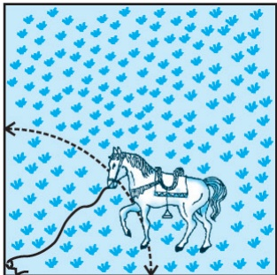

So,

$$
\begin{aligned} area of   \Delta  OAB  &= \frac{1}{2}  AB  \times  OM  = \frac{1}{2} \times 21\sqrt{3} \times \frac{21}{2}  cm ^2 \\&= \frac{441}{4} \sqrt{3}  cm ^2\end{aligned}\tag{3}
$$

Therefore, area of the segment $\mathrm{AYB} = \left(462 - \frac{441}{4}\sqrt{3}\right) \mathrm{cm}^2$ [From (1), (2) and (3)] $=   \frac{21}{4}   ( 88 - 21\sqrt{3} )  cm ^2$

# EXERCISE 11.1

Unless stated otherwise, use $\pi = { \frac { 2 2 } { 7 } }$

**1.** Find the area of a sector of a circle with radius 6 cm if angle of the sector is $6 0 ^ { \circ }$

**2.** Find the area of a quadrant of a circle whose circumference is 22 cm.

**3.** The length of the minute hand of a clock is 14 cm. Find the area swept by the minute hand in 5 minutes.

**4.** A chord of a circle of radius 10 cm subtends a right angle at the centre. Find the area of the corresponding : (i) minor segment (ii) major sector. (Use $\pi   =   3 . 1 4 )$

**5.** In a circle of radius 21 cm, an arc subtends an angle of $6 0 ^ { \circ }$ at the centre. Find:

(i) the length of the arc (ii) area of the sector formed by the arc

(iii) area of the segment formed by the corresponding chord

**6.** A chord of a circle of radius 15 cm subtends an angle of $6 0 ^ { \circ }$ at the centre. Find the areas of the corresponding minor and major

(Use   = 3.14 and $\sqrt{3} = 1.73$

**7.** A chord of a circle of radius 12 cm subtends an angle of $1 2 0 \%$ at the centre. Find the area of the corresponding segment of the circle.

(Use   = 3.14 and ${ \sqrt { 3 } }   =   1 . 7 3 )$

**8.** A horse is tied to a peg at one corner of a square shaped grass field of side 15 m by means of a $5$ m long rope (see Fig. 11.8). Find

Fig. 11.8