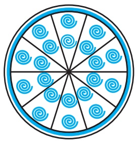
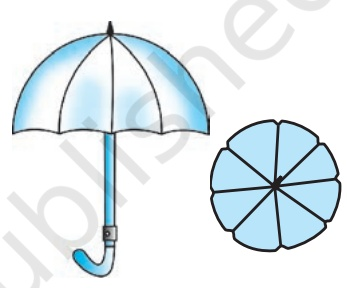
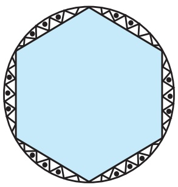

(i) the area of that part of the field in which the horse can graze.

(ii) the increase in the grazing area if the rope were 10 m long instead of 5 m. (Use   = 3.14)

**9.** A brooch is made with silver wire in the form of a circle with diameter 35 mm. The wire is also used in making 5 diameters which divide the circle into 10 equal sectors as shown in Fig. 11.9. Find :

Fig. 11.9

(i) the total length of the silver wire required.

(ii) the area of each sector of the brooch.

**10.** An umbrella has 8 ribs which are equally spaced (see Fig. 11.10). Assuming umbrella to be a flat circle of radius 45 cm, find the area between the two consecutive ribs of the umbrella.

**11.** A car has two wipers which do not overlap. Each wiper has a blade of length 25 cm sweeping through an angle of 115°. Find the total area cleaned at each sweep of the blades.

Fig. 11.10

**12.** To warn ships for underwater rocks, a lighthouse spreads a red coloured light over a sector of angle $8 0 ^ { \circ }$ to a distance of 16.5 km. Find the area of the sea over which the ships are warned. (Use   = 3.14)

**13.** A round table cover has six equal designs as shown in Fig. 11.11. If the radius of the cover is 28 cm, find the cost of making the designs at the rate of \` 0.35 per cm2. (Use $\left( { \sqrt { 3 } } = 1 . 7 \right)$

Fig. 11.11

**14.** Tick the correct answer in the following : Area of a sector of angle p (in degrees) of a circle with radius R is (A) ${ \frac { p } { 1 8 0 } }   \times 2   \pi \mathrm { R }$ (B) $\frac { p } { 1 8 0 } \times \pi \mathrm { R } ^ { 2 }$ (C) ${ \frac { p } { 3 6 0 } } \times 2   \pi \mathrm { R }$ (D) $\frac { p } { 7 2 0 }   \times   2 \pi \mathsf { R } ^ { 2 }$