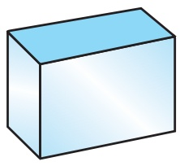
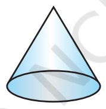
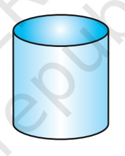
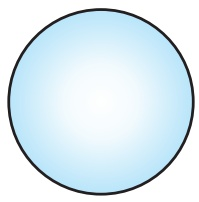
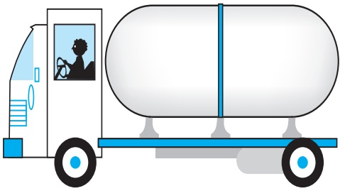

# 12SURFACE AREAS ANDVOLUMES

## 12.1 Introduction

**From Class IX, you are familiar with some of the solids like cuboid, cone, cylinder, and sphere (see Fig. 12.1). You have also learnt how to find their surface areas and volumes.**

(i)

(ii)

(iii)

(iv)

Fig. 12.1

**In our day-to-day life, we come across a number of solids made up of combinations of two or more of the basic solids as shown above.**

**You must have seen a truck with a container fitted on its back (see Fig. 12.2), carrying oil or water from one place to another. Is it in the shape of any of the four basic solids mentioned above? You may guess that it is made of a cylinder with two hemispheres as its ends.**

Fig. 12.2