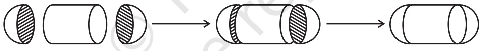

Again, you may have seen an object like the one in Fig. 12.3. Can you name it? A test tube, right! You would have used one in your science laboratory. This tube is also a combination of a cylinder and a hemisphere. Similarly, while travelling, you may have seen some big and beautiful buildings or monuments made up of a combination of solids mentioned above.

If for some reason you wanted to find the surface areas, or volumes, or capacities of such objects, how would you do it? We cannot classify these under any of the solids you have already studied.

Fig. 12.3

In this chapter, you will see how to find surface areas and volumes of such objects.

## 12.2 Surface Area of a Combination of Solids

Let us consider the container seen in Fig. 12.2. How do we find the surface area of such a solid? Now, whenever we come across a new problem, we first try to see, if we can break it down into smaller problems, we have earlier solved. We can see that this solid is made up of a cylinder with two hemispheres stuck at either end. It would look like what we have in Fig. 12.4, after we put the pieces all together.

Fig. 12.4

If we consider the surface of the newly formed object, we would be able to see only the curved surfaces of the two hemispheres and the curved surface of the cylinder.

So, the total surface area of the new solid is the sum of the curved surface areas of each of the individual parts. This gives,

TSA of new solid = CSA of one hemisphere + CSA of cylinder

\+ CSA of other hemisphere

where TSA, CSA stand for ‘Total Surface Area’ and ‘Curved Surface Area respectively.

Let us now consider another situation. Suppose we are making a toy by putting together a hemisphere and a cone. Let us see the steps that we would be going through.