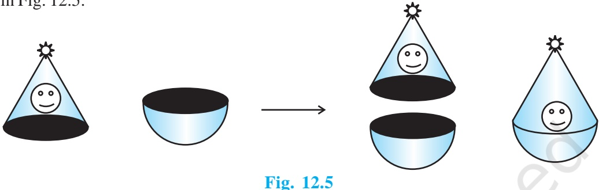
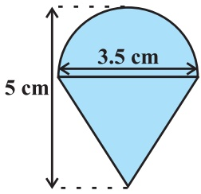

First, we would take a cone and a hemisphere and bring their flat faces together. Here, of course, we would take the base radius of the cone equal to the radius of the hemisphere, for the toy is to have a smooth surface. So, the steps would be as shown in Fig. 12.5.

At the end of our trial, we have got ourselves a nice round-bottomed toy. Now if we want to find how much paint we would require to colour the surface of this toy, what would we need to know? We would need to know the surface area of the toy, which consists of the CSA of the hemisphere and the CSA of the cone.

So, we can say:

Total surface area of the toy = CSA of hemisphere + CSA of cone

Now, let us consider some examples.

**Example 1 :** Rasheed got a playing top (lattu) as his birthday present, which surprisingly had no colour on it. He wanted to colour it with his crayons. The top is shaped like a cone surmounted by a hemisphere (see Fig 12.6). The entire top is 5 cm in height and the diameter of the top is 3.5 cm. Find the area he

has to colour. (Take $\pi = \frac { 2 2 } { 7 }$

Fig. 12.6

**Solution :** This top is exactly like the object we have discussed in Fig. 12.5. So, we can conveniently use the result we have arrived at there. That is :

TSA of the toy = CSA of hemisphere + CSA of cone

Now, the curved surface area of the hemisphere $\frac{1}{2}(4\pi r^{2})=2\pi r^{2}$ 22 3.5 3.5 = 2× 2 2 2  cm