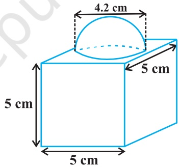

Also, the height of the cone = height of the top – height (radius) of the hemispherical part

$$
\left(5 - \frac{3.5}{2}\right) cm  = 3.25   cm
$$

So, the slant height of the cone $(l)=\sqrt{r^{2}+h^{2}}=\sqrt{\left(\frac{3.5}{2}\right)^{2}+\left(3.25\right)^{2}}\ cm=3.7\ cm(appox.)$

Therefore, CSA of cone $\pi r l = \left( \frac{22}{7} \times \frac{3.5}{2} \times 3.7 \right)  cm ^2$

This gives the surface area of the top as

$$
\left(2 \times \frac{22}{7} \times \frac{3.5}{2} \times \frac{3.5}{2}\right)  cm ^2 + \left(\frac{22}{7} \times \frac{3.5}{2} \times 3.7\right)  cm ^2
$$

$$
\frac{22}{7} \times \frac{3.5}{2} (3.5 + 3.7)  cm ^2 = \frac{11}{2} \times (3.5 + 3.7)  cm ^2 = 39.6  cm ^2 ( approach. )
$$

You may note that total surface area of the top' is not the sum of the total

surface areas of the cone and hemisphere.

Example 2 : The decorative block shown in Fig. 12.7 is made of two solids — a cube and a hemisphere. The base of the block is a cube with edge 5 cm, and the hemisphere fixed on the top has a diameter of 4.2 cm. Find the total surface area of the block. (Take $\pi =   { \frac { 2 2 } { 7 } }   )$

Fig. 12.7

Solution : The total surface area of the cube $6 \times (  edge  )^{2} = 6 \times 5 \times 5  cm ^{2} = 150  cm ^{2}$ Note that the part of the cube where the hemisphere is attached is not included in the surface area.

$$
\begin{aligned}\text { the surface area of the block } & = \text { TSA of cube - base area of themisphere } \\& \quad + \text { CSA of themisphere } \\& = 150 - \pi r^{2} + 2 \pi r^{2} = (150 + \pi r^{2}) \mathrm{cm}^{2} \\& = 150 \mathrm{cm}^{2} + \left(\frac{22}{7} \times \frac{4.2}{2} \times \frac{4.2}{2}\right) \mathrm{cm}^{2} \\& = (150 + 13.86) \mathrm{cm}^{2} = 163.86 \mathrm{cm}^{2}\end{aligned}
$$