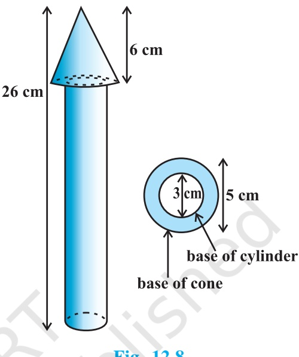

**Example 3 :** A wooden toy rocket is in the shape of a cone mounted on a cylinder, as shown in Fig. 12.8. The height of the entire rocket is 26 cm, while the height of the conical part is 6 cm. The base of the conical portion has a diameter of 5 cm, while the base diameter of the cylindrical portion is 3 cm. If the conical portion is to be painted orange and the cylindrical portion yellow, find the area of the rocket painted with each of these colours. (Take   = 3.14)

**Solution :** Denote radius of cone by r, slant height of cone by l, height of cone by h, radius of cylinder by $r ^ { \prime }$ and height of cylinder by h . Then r = 2.5 cm, h = 6 cm, r  = 1.5 cm, $h^{\prime} = 26 - 6 = 20$ cm and

$$
l = \sqrt{r^{2} + h^{2}} = \sqrt{2.5^{2} + 6^{2}}  cm  = 6.5  cm
$$

Here, the conical portion has its circular base resting on the base of the cylinder, but the base of the cone is larger than the base of the cylinder. So, a part of the base of the cone (a ring) is to be painted.

So, the area to be painted orange CSA of the cone + base area of the cone base area of the cylinder

$$
\begin{aligned} &=   \pi r l   +   \pi r^{2}   -   \pi (r^{\prime})^{2} \\&=   \pi [ (2.5 \times 6.5)   +   (2.5)^{2}   -   (1.5)^{2} ] \;  cm ^{2} \\&=   \pi [20.25] \;  cm ^{2}   =   3.14 \times 20.25 \;  cm ^{2} \\&=   63.585 \;  cm ^{2}\\ \end{aligned}
$$

Now, the area to be painted yellow = CSA of the cylinder + area of one base of the cylinder = 2πr′h′ + π(r′)² = πr′ (2h′ + r′) = (3.14 × 1.5) (2 × 20 + 1.5) cm2 = 4.71 × 41.5 cm2 = 195.465 cm2