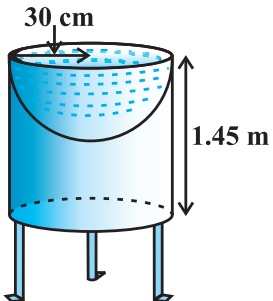
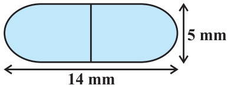

**Example 4 :** Mayank made a bird-bath for his garden in the shape of a cylinder with a hemispherical depression at one end (see Fig. 12.9). The height of the cylinder is 1.45 m and its radius is 30 cm. Find the total surface area of the bird-bath. (Take $\pi   =   \frac { 2 2 } { 7 } \; )$

**Solution :** Let h be height of the cylinder, and r the common radius of the cylinder and hemisphere. Then,

Fig. 12.9

the total surface area of the b $\begin{aligned}\mathrm{grid-batch} &= \mathrm{CSA}   of   \mathrm{cylinder} + \mathrm{CSA}   of   \mathrm{h} \\&= 2\pi r h + 2\pi r^2 = 2\pi r(h + r) \\&= 2 \times \frac{22}{7} \times 30(145 + 30)   \mathrm{cm}^2 \\&= 33000   \mathrm{cm}^2 = 3.3   \mathrm{m}^2\end{aligned}$ hemisphere

## EXERCISE 12.1

Unless stated otherwise, take $\pi = \frac { 2 2 } { 7 } .$

**1.** 2 cubes each of volume 64 cm3 are joined end to end. Find the surface area of the resulting cuboid.

**2.** A vessel is in the form of a hollow hemisphere mounted by a hollow cylinder. The diameter of the hemisphere is 14 cm and the total height of the vessel is 13 cm. Find the inner surface area of the vessel.

**3.** A toy is in the form of a cone of radius 3.5 cm mounted on a hemisphere of same radius. The total height of the toy is 15.5 cm. Find the total surface area of the toy.

**4.** A cubical block of side 7 cm is surmounted by a hemisphere. What is the greatest diameter the hemisphere can have? Find the surface area of the solid.

**5.** A hemispherical depression is cut out from one face of a cubical wooden block such that the diameter l of the hemisphere is equal to the edge of the cube. Determine the surface area of the remaining solid.

**6.** A medicine capsule is in the shape of a cylinder with two hemispheres stuck to each of its ends (see Fig. 12.10). The length of the entire capsule is 14 mm and the diameter of the capsule is 5 mm. Find its surface area.

Fig. 12.10