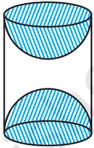
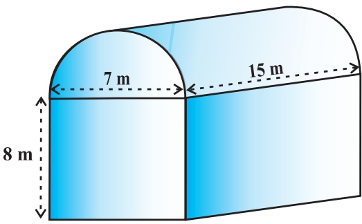

**7.** A tent is in the shape of a cylinder surmounted by a conical top. If the height and diameter of the cylindrical part are 2.1 m and 4 m respectively, and the slant height of the top is 2.8 m, find the area of the canvas used for making the tent. Also, find the cost of the canvas of the tent at the rate of \` 500 per m2. (Note that the base of the tent will not be covered with canvas.)

**8.** From a solid cylinder whose height is 2.4 cm and diameter 1.4 cm, a conical cavity of the same height and same diameter is hollowed out. Find the total surface area of the remaining solid to the nearest cm2.

**9.** A wooden article was made by scooping out a hemisphere from each end of a solid cylinder, as shown in Fig. 12.11. If the height of the cylinder is 10 cm, and its base is of radius 3.5 cm, find the total surface area of the article.

Fig. 12.11

## 12.3 Volume of a Combination of Solids

In the previous section, we have discussed how to find the surface area of solids made up of a combination of two basic solids. Here, we shall see how to calculate their volumes. It may be noted that in calculating the surface area, we have not added the surface areas of the two constituents, because some part of the surface area disappeared in the process of joining them. However, this will not be the case when we calculate the volume. The volume of the solid formed by joining two basic solids will actually be the sum of the volumes of the constituents, as we see in the examples below.

**Example 5 :** Shanta runs an industry in a shed which is in the shape of a cuboid surmounted by a half cylinder (see Fig. 12.12). If the base of the shed is of dimension 7 m × 15 m, and the height of the cuboidal portion is 8 m, find the volume of air that the shed can hold. Further, suppose the machinery in the shed occupies a total space of $3 0 0 ~ \mathrm { m } ^ { 3 }$ , and there are 20 workers, each of whom occupy about $0 . 0 8   \mathrm { ~ m } ^ { 3 }$ space on an average. Then, how much air is in the shed? (Take $\pi = \frac { 2 2 } { 7 }   )$

Fig. 12.12