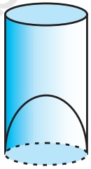

**Solution :** The volume of air inside the shed (when there are no people or machinery) is given by the volume of air inside the cuboid and inside the half cylinder, taken together.

Now, the length, breadth and height of the cuboid are 15 m, 7 m and 8 m, respectively. Also, the diameter of the half cylinder is 7 m and its height is 15 m.

So, the required volume = volume of the cuboid $+ \frac{1}{2}$ volume of the cylinder

$$
\left[15 \times 7 \times 8 + \frac{1}{2} \times \frac{22}{7} \times \frac{7}{2} \times \frac{7}{2} \times 15\right]  m ^3 = 1128.75  m ^3
$$

Next, the total space occupied by the machinery $= 3 0 0 \; \mathrm { m } ^ { 3 }$

And the total space occupied by the worker $s = 20 \times 0.08\  m ^3 = 1.6\  m ^3$

Therefore, the volume of the air, when there are machinery and workers

$$
1128.75-(300.00+1.60)=827.15\mathrm{~m}^{3}
$$

**Example 6 :** A juice seller was serving his customers using glasses as shown in Fig. 12.13. The inner diameter of the cylindrical glass was 5 cm, but the bottom of the glass had a hemispherical raised portion which reduced the capacity of the glass. If the height of a glass was 10 cm, find the apparent capacity of the glass and its actual capacity. (Use $\pi = 3.14.)$

Fig. 12.13

**Solution :** Since the inner diameter of the glass = 5 cm and height = 10 cm,

the apparent capacity of the glass =  r2h

$$
3.14 \times 2.5 \times 2.5 \times 10  cm ^3 = 196.25  cm ^3
$$

But the actual capacity of the glass is less by the volume of the hemisphere at the base of the glass.

i.e.,

it is less by $\frac{2}{3} \pi r^{3} = \frac{2}{3} \times 3.14 \times 2.5 \times 2.5 \times 2.5  cm ^{3} = 32.71  cm ^{3}$

So, the actual capacity of the glass = apparent capacity of glass – volume of the hemisphere $= \left( 196.25 - 32.71 \right)  cm ^3$ $= 1 6 3 . 5 4   \mathrm { c m } ^ { 3 }$