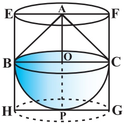

**Example 7 :** A solid toy is in the form of a hemisphere surmounted by a right circular cone. The height of the cone is 2 cm and the diameter of the base is 4 cm. Determine the volume of the toy. If a right circular cylinder circumscribes the toy, find the difference of the volumes of the cylinder and the toy. (Take $\pi = 3 . 1 4 )$

Fig. 12.14

**Solution :** Let BPC be the hemisphere and ABC be the cone standing on the base of the hemisphere (see Fig. 12.14). The radius BO of the hemisphere (as well as of the $\mathrm{core})=\frac{1}{2} \times 4 \mathrm{cm}=2 \mathrm{cm}$

$\mathrm { S o } ,$ volume of the $\mathrm{toy} = \frac{2}{3} \pi r^{3} + \frac{1}{3} \pi r^{2} h$

$$
\left[ \frac{2}{3} \times 3.14 \times (2)^3 + \frac{1}{3} \times 3.14 \times (2)^2 \times 2 \right]  cm ^3 = 25.12  cm ^3
$$

Now, let the right circular cylinder EFGH circumscribe the given solid. The radius of the base of the right circular cy $\mathrm{line} \mathrm{index} = \mathrm{HP} \equiv \mathrm{BO} = 2$ cm, and its height is

$$
EH = AO + OP = (2 + 2) cm = 4 cm
$$

So, the volume required = volume of the right circular cylinder – volume of the toy (3.14 × 22 × 4 – 25.12) cm3 25.12 cm3

Hence, the required difference of the two volumes = 25.12 cm3.

## EXERCISE 12.2

Unless stated otherwise, take $\widetilde { \pi   =   \frac { 2 2 } { 7 } }$

1. A solid is in the shape of a cone standing on a hemisphere with both their radii being equal to 1 cm and the height of the cone is equal to its radius. Find the volume of the solid in terms of  .

**2.** Rachel, an engineering student, was asked to make a model shaped like a cylinder with two cones attached at its two ends by using a thin aluminium sheet. The diameter of the model is 3 cm and its length is 12 cm. If each cone has a height of 2 cm, find the volume of air contained in the model that Rachel made. (Assume the outer and inner dimensions of the model to be nearly the same.)