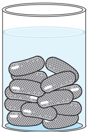
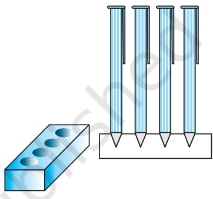

**3.** A gulab jamun, contains sugar syrup up to about 30% of its volume. Find approximately how much syrup would be found in 45 gulab jamuns, each shaped like a cylinder with two hemispherical ends with length 5 cm and diameter 2.8 cm (see Fig. 12.15).

**4.** A pen stand made of wood is in the shape of a cuboid with four conical depressions to hold pens. The dimensions of the cuboid are 15 cm by 10 cm by 3.5 cm. The radius of each of the depressions is 0.5 cm and the depth is 1.4 cm. Find the volume of wood in the entire stand (see Fig. 12.16).

**5.** A vessel is in the form of an inverted cone. Its height is 8 cm and the radius of its top, which is open, is 5 cm. It is filled with water up to the brim. When lead shots, each of which is a sphere of radius 0.5 cm are dropped into the vessel, one-fourth of the water flows out. Find the number of lead shots dropped in the vessel.

Fig. 12.15

Fig. 12.16

**6.** A solid iron pole consists of a cylinder of height 220 cm and base diameter 24 cm, which is surmounted by another cylinder of height 60 cm and radius 8 cm. Find the mass of the pole, given that 1 cm³ of iron has approximately 8g mass. (Use π = 3.14)

**7.** A solid consisting of a right circular cone of height 120 cm and radius 60 cm standing on a hemisphere of radius 60 cm is placed upright in a right circular cylinder full of water such that it touches the bottom. Find the volume of water left in the cylinder, if the radius of the cylinder is 60 cm and its height is 180 cm.

**8.** A spherical glass vessel has a cylindrical neck 8 cm long, 2 cm in diameter; the diameter of the spherical part is 8.5 cm. By measuring the amount of water it holds, a child finds its volume to be 345 cm3. Check whether she is correct, taking the above as the inside measurements, and   = 3.14.

## 12.4 Summary

In this chapter, you have studied the following points:

**1.** To determine the surface area of an object formed by combining any two of the basic solids, namely, cuboid, cone, cylinder, sphere and hemisphere.

**2.** To find the volume of objects formed by combining any two of a cuboid, cone, cylinder, sphere and hemisphere.