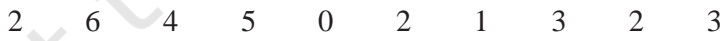

**8.** A class teacher has the following absentee record of 40 students of a class for the whole term. Find the mean number of days a student was absent.

| Number of days | 0 - 6 | 6 - 10 | 10 - 14 | 14 - 20 | 20 - 28 | 28 - 38 | 38 - 40 |
| --- | --- | --- | --- | --- | --- | --- | --- |
| Number of students | 11 | 10 | 7 | 4 | 4 | 3 | 1 |

**9.** The following table gives the literacy rate (in percentage) of 35 cities. Find the mean literacy rate.

| Literacy rate (in %) | 45 - 55 | 55 - 65 | 65 - 75 | 75 - 85 | 85 - 95 |
| --- | --- | --- | --- | --- | --- |
| Number of cities | 3 | 10 | 11 | 8 | 3 |

## 13.3 Mode of Grouped Data

Recall from Class IX, a mode is that value among the observations which occurs most often, that is, the value of the observation having the maximum frequency. Further, we discussed finding the mode of ungrouped data. Here, we shall discuss ways of obtaining a mode of grouped data. It is possible that more than one value may have the same maximum frequency. In such situations, the data is said to be multimodal. Though grouped data can also be multimodal, we shall restrict ourselves to problems having a single mode only.

Let us first recall how we found the mode for ungrouped data through the following example.

**Example 4 :** The wickets taken by a bowler in 10 cricket matches are as follows:

Find the mode of the data.

**Solution :** Let us form the frequency distribution table of the given data as follows:

| Number of wickets | 0 | 1 | 2 | 3 | 4 | 5 | 6 |
| --- | --- | --- | --- | --- | --- | --- | --- |
| Number of matches | 1 | 1 | 3 | 2 | 1 | 1 | 1 |