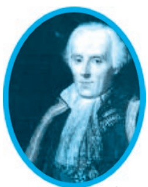

Probability theory had its origin in the 16th century when an Italian physician and mathematician J.Cardan wrote the first book on the subject, The Book on Games of Chance. Since its inception, the study of probability has attracted the attention of great mathematicians. James Bernoulli (1654 – 1705), A. de Moivre (1667 – 1754), and Pierre Simon Laplace are among those who made significant contributions to this field. Laplace’s Theorie Analytique des Probabilités, 1812, is considered to be the greatest contribution by a single person to the theory of probability. In recent years, probability has been used extensively in many areas such as biology, economics, genetics, physics, sociology etc.

Pierre Simon Laplace (1749 – 1827)

Let us find the probability for some of the events associated with experiments where the equally likely assumption holds.

**Example 1 :** Find the probability of getting a head when a coin is tossed once. Also find the probability of getting a tail.

**Solution :** In the experiment of tossing a coin once, the number of possible outcomes is two — Head (H) and Tail (T). Let E be the event ‘getting a head’. The number of outcomes favourable to E, (i.e., of getting a head) is 1. Therefore,

$$
\mathrm{P}(\mathrm{E})=\mathrm{P}(\mathrm{head})=\frac{\text { Number of outcomes forourable to E}}{\text { Number of all possible outcomes }}=\frac{1}{2}
$$

Similarly, if F is the event ‘getting a tail’, then

$$
\mathrm{P}(\mathrm{F}) = \mathrm{P}(\mathrm{tail}) = \frac{1}{2} \quad (\mathrm{Why~?})
$$

**Example 2 :** A bag contains a red ball, a blue ball and a yellow ball, all the balls being of the same size. Kritika takes out a ball from the bag without looking into it. What is the probability that she takes out the

(i) yellow ball?

(ii) red ball?

(iii) blue ball?

**Solution :** Kritika takes out a ball from the bag without looking into it. So, it is equally likely that she takes out any one of them.