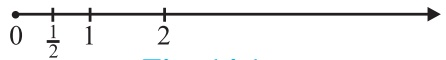

**Example 9 :** Harpreet tosses two different coins simultaneously (say, one is of \` 1 and other of \` 2). What is the probability that she gets at least one head?

**Solution :** We write H for ‘head’ and T for ‘tail’. When two coins are tossed simultaneously, the possible outcomes are (H, H), (H, T), (T, H), (T, T), which are all equally likely. Here (H, H) means head up on the first coin (say on \` 1) and head up on the second coin (\` 2). Similarly (H, T) means head up on the first coin and tail up on the second coin and so on.

The outcomes favourable to the event E, ‘at least one head’ are (H, H), (H, T) and (T, H). (Why?)

So, the number of outcomes favourable to E is 3.

Therefore,

$$
\mathrm { P ( E ) } = { \frac { 3 } { 4 } }
$$

i.e., the probability that Harpreet gets at least one head is $\frac { 3 } { 4 } \cdot$

**Note :** You can also find P(E) as follows:

$$
\mathrm{P}(\mathrm{E}) = 1 - \mathrm{P}(\mathrm{E}) = 1 - \frac{1}{4} = \frac{3}{4} \quad \left( \mathrm{Since} \mathrm{P}(\mathrm{E}) = \mathrm{P}(\mathrm{no} \mathrm{head}) = \frac{1}{4} \right)
$$

Did you observe that in all the examples discussed so far, the number of possible outcomes in each experiment was finite? If not, check it now.

There are many experiments in which the outcome is any number between two given numbers, or in which the outcome is every point within a circle or rectangle, etc. Can you now count the number of all possible outcomes? As you know, this is not possible since there are infinitely many numbers between two given numbers, or there are infinitely many points within a circle. So, the definition of (theoretical) probability which you have learnt so far cannot be applied in the present form. What is the way out? To answer this, let us consider the following example :

**Example 10\* :** In a musical chair game, the person playing the music has been advised to stop playing the music at any time within 2 minutes after she starts playing. What is the probability that the music will stop within the first half-minute after starting?

**Solution :** Here the possible outcomes are all the numbers between 0 and 2. This is the portion of the number line from 0 to 2 (see Fig. 14.1).

Fig. 14.1

<small>\* Not from the examination point of view.</small>