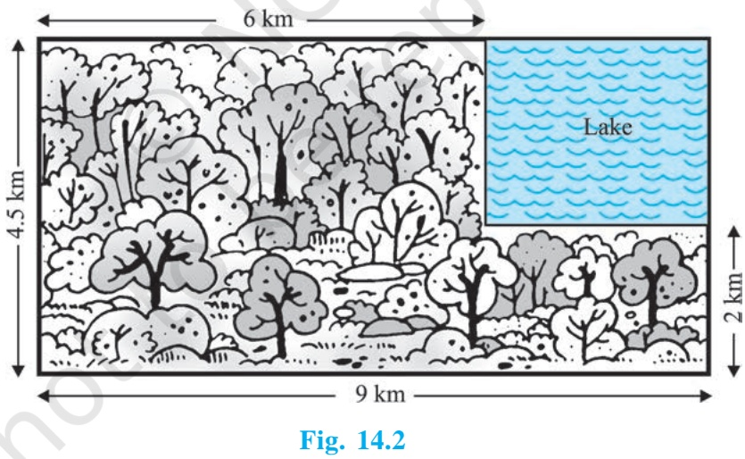

Let E be the event that ‘the music is stopped within the first half-minute’.

The outcomes favourable to E are points on the number line from 0 to $\frac { 1 } { 2 }$ .

The distance from 0 to 2 is 2, while the distance from 0 to $\frac { 1 } { 2 }$ is $\frac { 1 } { 2 }$ .

Since all the outcomes are equally likely, we can argue that, of the total distance of 2, the distance favourable to the event E is $\frac { 1 } { 2 }$

So,

$$
\mathrm{P}(\mathrm{E})=\frac{\text { Distance forourable to the event E }}{\text { Total distance in which outcomes can lie }}=\frac{\frac{1}{2}}{\frac{1}{4}}
$$

Can we now extend the idea of Example 10 for finding the probability as the ratio of the favourable area to the total area?

**Example 11\* :** A missing helicopter is reported to have crashed somewhere in the rectangular region shown in Fig. 14.2. What is the probability that it crashed inside the lake shown in the figure?

**Solution :** The helicopter is equally likely to crash anywhere in the region. Area of the entire region where the helicopter can crash $(4.5 \times 9)    km ^2 = 40.5    km ^2$

<small>\* Not from the examination point of view.</small>