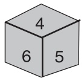
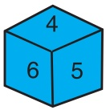
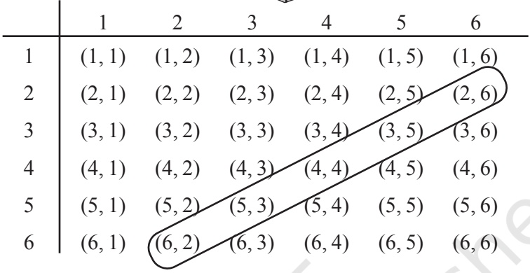

Fig. 14.3

**Note that the pair (1, 4) is different from (4, 1). (Why?) So, the number of possible outcomes = 6 × 6 = 36.**

**(i) The outcomes favourable to the event ‘the sum of the two numbers is** $8 ^ { \circ }$ **d**enoted **by E, are: (2, 6), (3, 5), (4, 4), (5, 3), (6, 2) (see Fig. 14.3)** i.e., the number of outcomes favourable to $\mathrm { E } = 5$ **Hence,** $P(E) = \frac{5}{36}$

**(ii) As you can see from Fig. 14.3, there is no outcome favourable to the event F, ‘the sum of two numbers is 13’.** 0 **So, P(F) =** 0 **36**

(iii) As you can see from Fig. 14.3, all the outcomes are favourable to the event $\mathrm { G }$ **‘sum of two numbers** $\leq 1 2 ^ { \star }$

**So,**

$$
\mathrm { P ( G ) }   =   \frac { 3 6 } { 3 6 }   =   1
$$