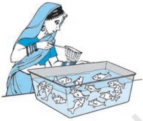
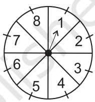

**10.** A piggy bank contains hundred 50p coins, fifty \` 1 coins, twenty \` 2 coins and ten \` 5 coins. If it is equally likely that one of the coins will fall out when the bank is turned upside down, what is the probability that the coin (i) will be a 50 p coin ? (ii) will not be a \` 5 coin?

**11.** Gopi buys a fish from a shop for his aquarium. The shopkeeper takes out one fish at random from a tank containing 5 male fish and 8 female fish (see Fig. 14.4). What is the probability that the fish taken out is a male fish?

**12.** A game of chance consists of spinning an arrow which comes to rest pointing at one of the numbers 1, 2, 3, 4, 5, 6, 7, 8 (see Fig. 14.5 ), and these are equally likely outcomes. What is the probability that it will point at (i) 8 ? (ii) an odd number? (iii) a number greater than 2? (iv) a number less than 9?

Fig. 14.4

Fig. 14.5 0

**13.** A die is thrown once. Find the probability of getting (i) a prime number; (ii) a number lying between 2 and 6; (iii) an odd number.

**14.** One card is drawn from a well-shuffled deck of 52 cards. Find the probability of getting (i) a king of red colour (ii) a face card (iii) a red face card (iv) the jack of hearts (v) a spade (vi) the queen of diamonds

**15.** Five cards—the ten, jack, queen, king and ace of diamonds, are well-shuffled with their face downwards. One card is then picked up at random.

(i) What is the probability that the card is the queen?

(ii) If the queen is drawn and put aside, what is the probability that the second card picked up is (a) an ace? (b) a queen?

**16.** 12 defective pens are accidentally mixed with 132 good ones. It is not possible to just look at a pen and tell whether or not it is defective. One pen is taken out at random from this lot. Determine the probability that the pen taken out is a good one.

**17.** (i) A lot of 20 bulbs contain 4 defective ones. One bulb is drawn at random from the lot. What is the probability that this bulb is defective?

(ii) Suppose the bulb drawn in (i) is not defective and is not replaced. Now one bulb is drawn at random from the rest. What is the probability that this bulb is not defective ?

**18.** A box contains 90 discs which are numbered from 1 to 90. If one disc is drawn at random from the box, find the probability that it bears (i) a two-digit number (ii) a perfect square number (iii) a number divisible by 5.