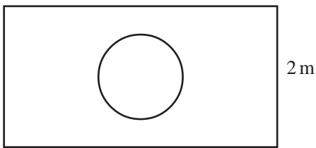

**19.** A child has a die whose six faces show the letters as given below:

The die is thrown once. What is the probability of getting (i) A? (ii) D?

**20\*.** Suppose you drop a die at random on the rectangular region shown in Fig. 14.6. What is the probability that it will land inside the circle with diameter 1m?

3 m

Fig. 14.6

**21.** A lot consists of 144 ball pens of which 20 are defective and the others are good. Nuri will buy a pen if it is good, but will not buy if it is defective. The shopkeeper draws one pen at random and gives it to her. What is the probability that

(i) She will buy it ?

(ii) She will not buy it ?

**22.** Refer to Example 13. (i) Complete the following table:

| Event : 'Sum on 2 dice' | 2 | 3 | 4 | 5 | 6 | 7 | 8 | 9 | 10 | 11 | 12 |
| --- | --- | --- | --- | --- | --- | --- | --- | --- | --- | --- | --- |
| Probability | 136 |  |  |  |  |  | 536 |  |  |  | 136 |

(ii) A student argues that ‘there are 11 possible outcomes 2, 3, 4, 5, 6, 7, 8, 9, 10, 11 and 12. Therefore, each of them has a probability $\frac { 1 } { 1 1 }$ . Do you agree with this argument? Justify your answer.

**23.** A game consists of tossing a one rupee coin 3 times and noting its outcome each time. Hanif wins if all the tosses give the same result i.e., three heads or three tails, and loses otherwise. Calculate the probability that Hanif will lose the game.

**24.** A die is thrown twice. What is the probability that

(i) 5 will not come up either time? (ii) 5 will come up at least once?

[**Hint :** Throwing a die twice and throwing two dice simultaneously are treated as the same experiment]

<small>\* Not from the examination point of view.</small>