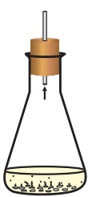
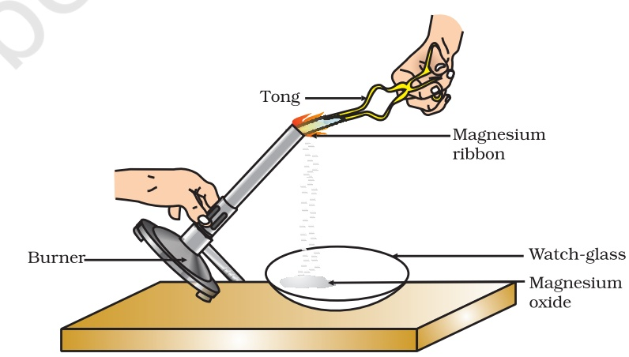

CHAPTER1

# Chemical Reactions and Equations

1064CH01

**onsider the following situations of daily life and think what happens when –**

n **milk is left at room temperature during summers.**

n **an iron tawa/pan/nail is left exposed to humid atmosphere.**

n **grapes get fermented.**

n **food is cooked.**

n **food gets digested in our body.**

n **we respire.**

**In all the above situations, the nature and the identity of the initial substance have somewhat changed. We have already learnt about physical and chemical changes of matter in our previous classes. Whenever a chemical change occurs, we can say that a chemical reaction has taken place.**

**You may perhaps be wondering as to what is actually meant by a chemical reaction. How do we come to know that a chemical reaction has taken place? Let us perform some activities to find the answer to these questions.**

## Activity 1.1

**CAUTION: This Activity needs the teacher’s assistance. It would be better if students wear suitable eyeglasses.**

**Clean a magnesium ribbon about 3-4 cm long by rubbing it with sandpaper.**

**Hold it with a pair of tongs. Burn it using a spirit lamp or burner and collect the ash so formed in a watch-glass as shown in Fig. 1.1. Burn the magnesium ribbon keeping it away as far as possible from your eyes.**

**What do you observe?**

Burning of a magnesium ribbon in air and collection of magnesium oxide in a watch-glass